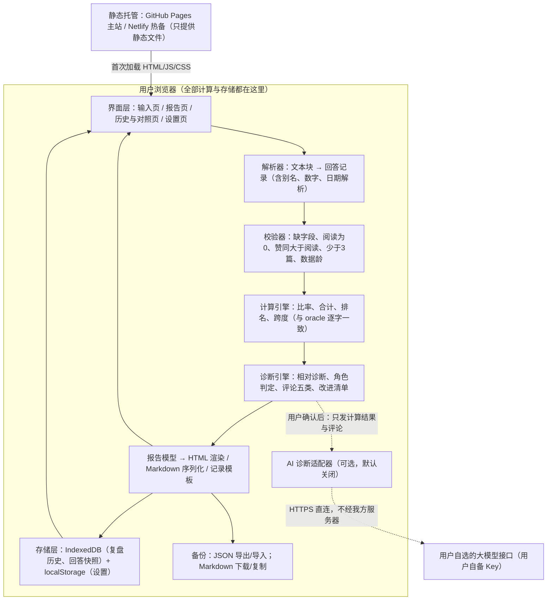
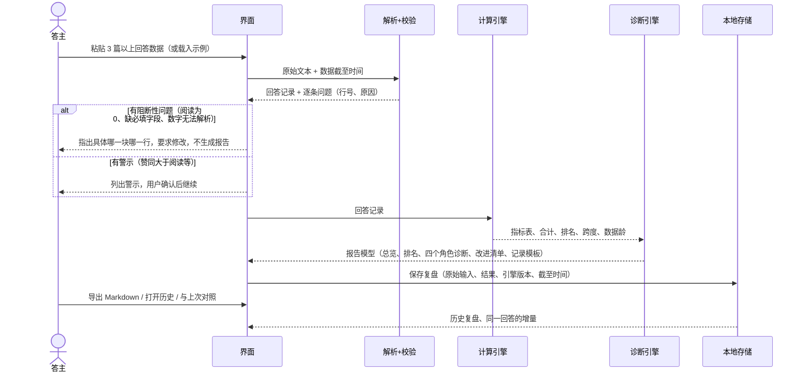

# 阶段一：可行性分析与架构设计 —— 知乎回答数据复盘助手

> 文档版本：v1.0（2026-11-25 18:00，UTC+8）
> 依据：`BRIEF.md`（唯一任务来源）、`reference/` 下 4 个参考文件
> 范围：只做阶段一（可行性分析与架构设计），**不含任何实现代码**。文中的“验证实验”是一次性可行性检查脚本，放在仓库外（见附录 A），不是产品代码。
> 标注约定：**【待核实】**＝赛事规则或平台口径未能从可靠来源确认；**【需决策】**＝需要你在验收时拍板；**【已验证】**＝本阶段实际跑过、有输出为证。

---

## 0. 本阶段验收标准复述（按 BRIEF §8、§9）

阶段一产物 `docs/01-feasibility-architecture.md` 必须包含：

| # | 验收项 | 本文位置 |
|---|---|---|
| A1 | 技术可行性 | §3 |
| A2 | 时间可行性（今天 11-25，提交窗口 12-05 10:00 — 12-07 10:00） | §6 |
| A3 | 原创性风险 | §5 |
| A4 | 架构（组件与数据流） | §7 |
| A5 | 技术选型（含备选方案与取舍理由） | §8 |
| A6 | 风险清单与应对 | §9 |
| A7 | 各阶段验收标准 | §10 |
| A8 | BRIEF §6 四个知乎版关键问题的论证（“阶段一重点”） | §4 |
| A9 | BRIEF §7 技术方向逐条“验证或推翻” | §1.2 |
| A10 | 不确定的赛事规则标“待核实”，不编造 | 全文 + §11 |

自查结果见 §12。

---

## 1. 结论摘要

### 1.1 总体结论：**可行，建议按计划推进（GO），有 3 个前提条件**

1. **核心流程技术上完全可行**：纯前端、本地计算、本地存储、无后端、免登录。计算口径移植到 JS 已用实验证明可以与 `review.py` **逐字一致**（25 万 + 10 万个用例 0 差异），但**直接照搬式移植会出错**（舍入规则不同，见 §3.1），必须按本文方案实现。
2. **时间可行但不宽裕**：从现在到 12-05 10:00 共约 9.7 天，有效开发约 5 个工作日。计划在 **12-04 18:00 冻结代码**，**12-05 窗口一开就提交**，12-06 全天做缓冲，不把 12-07 当作可用时间（§6）。
3. **三个前提**（详见 §11）：
   - P1 公网 Demo 在**中国大陆网络**下能打开——三个候选托管平台的默认域名在大陆都有可访问性风险，必须在阶段三第 1 天用真实大陆网络实测（§3.6、R1）。
   - P2 AI 场景价值占评审 40%，但核心流程是规则引擎、评委没有自己的 Key——AI 怎么让评委“看得见”需要你决定（§3.4、R2）。
   - P3 你需要在阶段四前提供**至少 3 篇自己账号（“山里的风”）的真实回答数据**，用于真实数据端到端测试（BRIEF §8 阶段四要求“真实数据”，本方不能编造）。

### 1.2 BRIEF §7 技术方向逐条验证结果

| BRIEF §7 建议 | 结论 | 依据 |
|---|---|---|
| 形态：静态单页 Web 应用 | **验证通过** | 核心流程无需服务端；静态站交付最稳，与“免登录”天然契合（§3） |
| 计算：`review.py` 移植到 JS，示例数据回归一致 | **验证通过，但有附加条件** | 【已验证】朴素移植在 247,030 个比率用例中 92 个格式化结果不同、在数字解析上存在“四舍六入五成双”差异；按 §3.1 方案修正后 0 差异 |
| 存储：IndexedDB 或 localStorage | **选 IndexedDB**，localStorage 只存设置 | 历史需按回答跨期查询；容量与异步性更好；不可用时降级并明示（§8） |
| 后端：核心不需要；AI 走用户自备 Key 浏览器直连 | **验证通过（核心）/ 有条件通过（AI）** | 【已验证】DeepSeek、OpenAI、Moonshot、通义 DashScope 兼容接口的 CORS 预检均放行任意来源；智谱预检未返回 CORS 头【待核实】（§3.4） |
| 部署：GitHub Pages / Vercel / Netlify 三选一 | **选 GitHub Pages 为主站，Netlify 为热备镜像；否决 Vercel** | `*.vercel.app` 在大陆普遍被 DNS 污染；其余两家“时好时坏”，需实测定案（§3.6） |
| 不接知乎开放 API 做核心；不做账号；不做服务端数据库 | **维持** | OAuth 换 token 通常需要服务端保存密钥，与“无后端”冲突；开放平台文档细节【待核实】（§3.5） |

### 1.3 BRIEF §6 四个关键问题的结论（详见 §4）

| 问题 | 结论 |
|---|---|
| 指标口径 | 保留“赞同率 / 收藏率 / 评论率 / 互动率 = 对应数 ÷ 阅读”（与 oracle 一致，回归可验证）；但诊断**以分项比率和“收赞比”（收藏 ÷ 赞同）为主**，互动率只作为排名键，并在报告中说明知乎三种动作含义不同 |
| 参考线 | **选方案②：放弃绝对阈值，改用相对诊断**（本批排名、与本批中位数的倍数、与本人历史基线对照、可选的同类回答对照）。理由：没有找到知乎官方或可靠公开数据；检索到的社区说法来源不明、随领域和流量规模剧烈变化 |
| 发布时间 | “未满 7 天不排名”**不直接沿用**：改为“满 3 篇照常排名，但每篇标注**数据龄**（复盘时点 − 发布时间），数据龄不足的结论降级为‘仅供参考’；7 天为默认提示阈值且可调”；用**同一回答的多次复盘增量**代替“等数据跑完” |
| 评论语义 | 按知乎语境重做分类：**追问 / 质疑求证 / 认可 / 收藏标记 / 催更蹲后续**五类，“质疑”优先于“追问”（如“来源？”是质疑不是提问）；改进建议以“**直接编辑原回答**”为第一抓手（知乎回答可随时编辑、长尾流量持续） |

---

## 2. 输入核实：参考资料核验结果

### 2.1 Oracle 复跑 【已验证】

本机环境：Python 3.12.3、Node v24.22.1。运行 `python3 reference/review.py reference/example-data.txt`，输出与 BRIEF §5 的“已知正确结果”**完全一致**：

| 项目 | Oracle 输出 |
|---|---|
| 合计 | 阅读 49200、（赞同口径）2630、收藏 2130、评论 414 |
| 总互动 / 平均互动率 | 5174 ÷ 49200 = 10.52%（总互动 ÷ 总阅读，不是各篇简单平均） |
| 各篇互动率 | 13.05% / 12.27% / 7.57%（最好与最差相差 5.48 个百分点） |
| 各篇分项比率 | 6.81/5.38/0.86；4.27/7.50/0.50；4.58/2.01/0.98（单位 %） |
| 收藏 ÷ 点赞（知乎版即“收赞比”） | 0.79 / 1.76 / 0.44 |
| 发布时间跨度 | 5 天（2026-11-16 至 2026-11-21） |
| 代表性评论“提问”计数 | 3/3、2/3、2/3 |

### 2.2 Oracle 的隐含行为（JS 移植必须复刻，否则回归会漂移）

| # | 行为 | 对移植的要求 |
|---|---|---|
| Q1 | 比率格式化用 Python `f"{x:.2f}"`：对**双精度的精确值**做“四舍六入五成双” | JS 的 `toFixed(2)` 在精确平局时取较大值，**会不一致**（§3.1 实测） |
| Q2 | 数字解析用 `int(round(v))`：Python `round` 是银行家舍入 | JS `Math.round` 是“.5 进位”，需自写半偶舍入 |
| Q3 | 比率计算顺序是 `part / whole * 100.0`（先除后乘，两次浮点舍入） | JS 必须同序计算，不能写成 `part * 100 / whole` |
| Q4 | 时间跨度是 `(max − min).days`，即**向下取整的整天数**，含时分 | JS 需按“无时区墙钟时间”计算（统一按 UTC 解析），避免用户浏览器时区/夏令时影响 |
| Q5 | 排序用稳定排序 + `reverse=True`，并列时保持输入顺序；`max()` 并列取第一个；阅读为 0 的按 −1 排最后 | JS `Array.prototype.sort` 自 ES2019 起稳定，按相同比较器即可；需专门写并列用例 |
| Q6 | 一个块中出现 `代表性评论：` 后，**该块后续所有行都当评论**（包括像“阅读量：xx”的行） | 兼容模式复刻；知乎版可在阶段二决定是否收紧（收紧须不影响 oracle 用例） |
| Q7 | 标签正则 `^([^：:]{1,12})[：:]\s*(.+)$`，按第一个冒号切分（标题里含“：”不受影响） | 原样复刻 |
| Q8 | 缺必填字段、数字解析失败的块被**跳过并告警**，不终止 | 知乎版必须把告警显示在界面上（BRIEF：不许静默失败） |
| Q9 | 分享数可选，解析但不进入任何比率 | 知乎版对“分享”“喜欢”同样处理（§4.1） |
| Q10 | 别名表里**没有“赞同”**；“点赞/赞”映射为同一字段 | 知乎版必须新增“赞同”等别名（§4.1），否则知乎用户的数据会被整块跳过 |
| Q11 | `review.py` **不做**“赞同 > 阅读”校验、不做“少于 3 篇不排名”、不做“未满 7 天”判断——这些在原 Skill 里是由执行者（大模型）口头执行的 | 知乎版需要把它们变成确定性规则并写测试（§4.3、§7） |

### 2.3 参考资料中发现的问题（说明为什么不能照搬）

- **原报告的“满 7 天”判断与输入矛盾**：`example-report.md` 的记录模板把 11-19 08:30 发布的一篇标为“已满 7 天”、11-21 那篇标为“未满 7 天”，这只有在复盘时点落在 11-26 08:30 至 11-28 19:00 之间才成立，但输入里**没有复盘时点**。以今天（11-25 18:00）计算，三篇的数据龄分别约 9.3 天、6.4 天、4.0 天，只有 1 篇满 7 天。→ 知乎版必须把**“数据截至时间”作为显式输入**（默认取生成报告的时刻，可修改）。
- **原规则混用了两个概念**：“发布时间跨度超过 7 天要提醒”（批内跨度）和“没满 7 天不排名”（单篇数据龄）是两回事。知乎版分开处理（§4.3）。
- **参考线是小红书经验值**：按知乎常见量级套用 10% 优秀线，绝大多数知乎回答都会被判为“偏弱”，诊断失去意义（§4.2）。
- `SKILL.md` 与 `review.py` 含“小红书”字样（4 处 + 1 处），且 `SKILL.md` 自述“已发布于华为云 Skill 市场和小红书 Skill 市场”——说明原 Skill 属于**已公开发布的项目**，原创性红线必须严格执行（§5）。

---

## 3. 技术可行性

### 3.1 计算引擎移植（关键风险，已用实验消除）【已验证】

**实验设计**（脚本见附录 A）：用 `review.py` 自身的 `rate()`、`fmt_pct()`、`parse_number()` 生成标准答案，与 JS 实现逐条比对。

- 比率用例 247,030 个：阅读 1–800 × 赞同 0–60 的穷举网格 + 20 万组随机（阅读最高 500 万）。
- 数字解析用例 100,000 个：随机整数 + 刻意加入 `.5`、`.05`、`.00005` 等平局小数 + “万/千/ 万”单位。

| 实现 | 比率格式化不一致 | 数字解析不一致 |
|---|---|---|
| 朴素移植（`toFixed(2)` + `Math.round`） | **92 / 247,030** | **6,296 / 100,000**（用例刻意偏重平局，真实数据中出现概率低） |
| 修正移植（精确十进制展开 + 半偶舍入） | **0 / 247,030** | **0 / 100,000** |

真实可能遇到的反例：**阅读 32、赞同 1** → Python 输出 `3.12%`，朴素 JS 输出 `3.13%`。知乎上低阅读量回答很常见，这类分母（2 的幂次相关）并不罕见，**不修正就会在真实数据上与 oracle 不一致**。

修正方法（阶段二写进接口设计，阶段三实现）：
- 格式化：先取双精度的精确十进制展开（JS `toFixed(100)` 对 |x| < 1e21 给出精确值），再在字符串上做“四舍六入五成双”。
- 取整：`floor` 后判断小数部分是否恰为 0.5（双精度下该减法是精确的），平局取偶。
- 回归策略：除示例数据外，**把上述 35 万个差分用例的生成方式纳入单元测试**（标准答案以 JSON 固化，不依赖运行时 Python）。

**结论：可行。** 计算核心是约 300 行无依赖纯函数，可同时在 Node（测试）和浏览器（产品）运行。

### 3.2 本地存储

- 数据量：一次复盘（3–20 篇 + 每篇 ≤ 5 条评论 + 报告）约 5–30 KB；IndexedDB 配额以百 MB 计，足够数千次复盘。
- 风险点：微信 / 知乎 App 内置浏览器、Safari 无痕模式下 IndexedDB 可能不可用或会被清理。→ 启动时探测，不可用则降级为“本次会话内存保存”并**在界面顶部明示**“当前环境无法本地保存，请导出 Markdown / 备份文件”。
- 提供“导出备份（JSON）/ 导入备份”，弥补浏览器存储被清理的风险。

**结论：可行。**

### 3.3 Markdown 导出与评委使用环境

- 桌面浏览器：`Blob` + `<a download>` 下载 `.md` 文件，可行。
- 移动端 / App 内置浏览器：下载常被拦截 → 同时提供**“复制 Markdown 到剪贴板”**按钮作为兜底；剪贴板 API 不可用时退化为“全选文本框”。
- 评委很可能在手机或微信里打开链接 → 页面必须响应式，核心流程在 375px 宽屏幕可走完（阶段四验收项）。

**结论：可行。**

### 3.4 AI 深度诊断（伸缩功能）

**浏览器直连可行性** 【已验证，2026-11-25 从本环境发出 CORS 预检（OPTIONS，Origin 设为 `https://example.github.io`）】：

| 服务（OpenAI 兼容接口） | 预检结果 |
|---|---|
| DeepSeek `api.deepseek.com` | 放行，回显来源，允许 `authorization,content-type` |
| OpenAI `api.openai.com` | 放行 |
| Moonshot `api.moonshot.cn` | 放行（204） |
| 通义 DashScope 兼容模式 | 放行（`*`） |
| 智谱 `open.bigmodel.cn` | 200 但**未返回 CORS 头**【待核实】 |
| Anthropic | 预检 400（需特殊请求头）【不建议首批支持】 |

> 注意：预检放行≠实际请求一定成功；阶段二需用真实 Key 做一次完整调用验证（由你本人操作，Key 不进入仓库与日志）。另外，网络检索摘要曾称“DeepSeek 不支持 CORS”，与实测相反——本文以实测为准，也说明二手资料需要核实。

**设计原则**（即使做，也不改变核心流程）：
- 大模型**不算数**：所有数字由确定性引擎算好，作为结构化输入交给模型；模型只做语义诊断（读评论、给改写建议），输出中引用的数字由程序校验是否存在于计算结果中，不存在的标红提示。
- 数据出浏览器前弹出明确告知（发送什么、发给谁），用户确认后才发送。
- Key 默认只存 `sessionStorage`（关页即删），勾选“记住”才存 `localStorage`；界面永不回显完整 Key。
- 失败分类提示：Key 无效、额度耗尽、网络不可达、超时、跨域被拒——各有中文说明，不静默失败。

**评分层面的问题（重要）【需决策】**：评审权重“AI 场景价值 40%”，但评委没有测试账号、也不会有自己的模型 Key，**仅 BYOK 意味着评委大概率体验不到 AI**。可选方案：

| 方案 | 内容 | 优点 | 代价 / 风险 |
|---|---|---|---|
| A | 仅 BYOK（BRIEF 原方案） | 零后端、零 Key 泄露面 | 评委看不到 AI 效果 |
| **A′（推荐默认）** | A + 对内置示例数据预先生成一份 AI 诊断，界面明确标注“示例输出（预先生成，非实时）” | 评委能看到 AI 增量价值，诚实、零后端 | 需要在说明书中讲清楚；不是实时调用 |
| B | 增加一个无服务器函数代理，使用我方 Key，限流、只对用户主动点击生效 | 评委可实时体验 | 引入后端与 Key 管理、费用、日志脱敏、数据出浏览器到我方；托管需改为 Netlify（GitHub Pages 无函数）；工期 +1.5 天 |

**结论：核心可行；AI 部分技术可行，展示方式待你决定**（默认按 A′ 规划，阶段三第 4 天视进度决定是否做，见 §6 闸门 G1）。

### 3.5 知乎 OAuth 一键导入（伸缩功能）

- 已确认存在“知乎数据开放平台”（`developer.zhihu.com`，页面描述含“Skills/API/MCP、搜索、直答、知识库、RAG、热榜”）。该站是单页应用，本阶段无法读到具体接口文档。
- 网络检索线索（二手、**未核实**）称平台提供“单篇创作数据 / 账号创作数据”接口（阅读、赞同、收藏、评论），鉴权使用 Access Secret（Bearer）并要求实名。【待核实】
- 技术障碍：标准 OAuth 授权码流程在换取 token 时需要客户端密钥，**纯静态站无法安全保存**，除非平台支持 PKCE 公共客户端【待核实】。否则必须引入服务端函数，这与“无后端”方向冲突，且所有凭证都受 BRIEF §2 的泄露红线约束。
- **结论：不进入核心流程，维持 BRIEF 判断。** 设决策闸门：若 **11-28 前**你确认（1）已拿到官方凭证，（2）文档明确支持静态站可用的授权方式或允许我们使用无服务器函数，（3）额度足够评审期使用——再评估是否做；否则本次不做，只在产品说明中写“后续规划”。
- 附带影响：产品说明书要求写“用到的知乎开放能力”。若 OAuth 不做，核心流程**不使用任何知乎开放接口**，这一项只能如实写“数据来自答主在知乎创作中心看到的自有数据，用户主动粘贴”。这可能影响“与知乎生态契合”的得分【需决策，见 §11 D3】。

### 3.6 部署与中国大陆可访问性

检索线索（二手、**未核实**，需实测）：`*.vercel.app` 在大陆普遍遭 DNS 污染；`*.pages.dev` 不稳定；`*.github.io` “半通”，时快时慢；`*.netlify.app` 存活率略高但同样不稳。Gitee Pages 已于 2024 年停止服务，不可选。

决策：
- **主站 GitHub Pages**：与代码仓库（加分项）同源、零成本、用 GitHub Actions 发布；仓库须公开（这也要求仓库里绝无凭证、绝无 `reference/` 内容，见 §5）。
- **热备 Netlify**：同一份构建产物同时发布，主站实测不可用时切换提交链接。
- **否决 Vercel**：默认域名在大陆不可用的报道最集中。
- **实测定案**：阶段三第 1 天先发布一个“空壳页”，由你在大陆网络（电信 / 联通 / 移动、手机 4G/5G、微信内打开）实测两个地址，记录结果后定主链接。
- **保底方案（超出 BRIEF 三选一范围）【需决策】**：两个都不可用时，备选（1）购买自定义域名并通过 Cloudflare 代理指向主站，（2）腾讯云 EdgeOne Pages（其大陆默认域名据称有访问时效限制【待核实】，自定义域名在大陆加速需 ICP 备案，时间上来不及）。
- 页面**不引用任何境外 CDN 资源**（Google Fonts、jsDelivr、unpkg 等在大陆慢或不可用），所有资源随站点打包。

**结论：技术可行，可访问性是最大不确定项，用“早发布、早实测、双站热备”应对。**

---

## 4. 知乎版必须重新解决的关键问题（BRIEF §6，阶段一重点）

### 4.1 指标口径

**知乎回答的可见指标**：阅读、赞同、收藏、评论；此外还有“喜欢”和“分享”。创作中心具体展示哪些字段、“阅读”如何计数（例如信息流中展开是否计入）、评论数是否包含楼中楼回复和作者自己的回复——**均未找到官方口径【待核实】**。

**公式（产品中写出，用户可验算）**：

- 赞同率 = 赞同 ÷ 阅读 × 100%
- 收藏率 = 收藏 ÷ 阅读 × 100%
- 评论率 = 评论 ÷ 阅读 × 100%
- 互动率 =（赞同 + 收藏 + 评论）÷ 阅读 × 100%
- 收赞比 = 收藏 ÷ 赞同
- 批次平均互动率 = 总互动 ÷ 总阅读 × 100%（加权，不是各篇简单平均）

**类推是否合理——论证**：

1. **“赞同 ÷ 阅读”在知乎有现成说法**：社区中常称“赞阅比”（检索线索，未找到官方定义）。它衡量“读过的人里有多少愿意公开背书”，在知乎语境下是有意义的——知乎的赞同会出现在赞同者的关注者动态中、并影响回答在问题下的排序，是**公开表态**。所以产品里命名为“赞同率”，并注明“社区也称赞阅比”。
2. **“收藏 ÷ 阅读”和“收藏 ÷ 赞同”在知乎尤其有信息量**：知乎收藏是私密的、工具性的行为（攒资料、以后再看）。社区普遍把“收藏多于赞同”视为干货/工具型回答的信号（检索线索）。因此**收赞比是知乎版的核心诊断指标之一**，不只是附属数字。
3. **评论在知乎含义混杂**：知乎评论区既有追问、认可，也有大量质疑、反驳、要信源（“来源？”）。评论率高≠被认可，必须结合评论语义（§4.4）。另外作者本人在评论区回复会抬高评论数【待核实是否计入】，报告中提示这一点。
4. **把三者相加的“互动率”在知乎是一个弱指标**：三种动作含义差异大，简单相加会掩盖结构差异（例如赞同高收藏低的观点型回答，与收藏高赞同低的工具型回答，互动率可能相同）。但 BRIEF 要求“互动率排名”且 oracle 以它为准，所以：**互动率保留为排名键（与 oracle 一致），诊断叙述以三个分项比率 + 收赞比为主**，报告中写一句说明。
5. **“喜欢”“分享”**：作为可选字段解析并单独列出，**不进入互动率**（与 oracle 对“分享”的处理一致，保证回归不变）。是否在表格中展示由阶段二定。
6. **术语红线**：所有面向用户的文案只用“赞同”，不出现“点赞”“笔记”“封面”。【需决策 D5】输入解析是否容忍用户习惯写的“点赞：123”（静默按“赞同”处理并提示）——推荐容忍，因为知乎用户日常口语也说“点赞”，拒收会制造无谓的报错；该别名只存在于解析器别名表中，不出现在任何界面和报告文案里。

**新增的输入别名（知乎版）**：赞同、赞同数、获赞同（→ 赞同）；阅读、阅读数、阅读量、浏览量（→ 阅读）；收藏数（→ 收藏）；评论数（→ 评论）；问题、回答标题（→ 标题）；喜欢、分享（可选）。具体清单阶段二定稿，每个别名都有单元测试。

### 4.2 参考线：选择方案②（相对诊断），放弃绝对阈值

**为什么不选方案①（找知乎参考值）**：

- 没有找到知乎官方发布的互动率/赞同率标准。
- 检索到的社区说法（例如“赞阅比 0.5%–1% 正常、1%–3% 优质”）来自二手内容汇总，**原始出处无法追溯**；同一来源自己也承认该比例随领域（情感/观点类高、技术/法律类低）和流量规模（进入大推荐后泛流量涌入，比例被稀释）剧烈变化。用它当绝对线，会系统性误判技术类答主和高流量回答。
- 把小红书的 10%/5% 线搬过来更不可取：按上述量级，几乎所有知乎回答都会被判“偏弱”。
- BRIEF §9：“遇到不确定的……不要编”。拿不出可验证来源的数字，不应进入诊断结论。

**方案②的具体设计（阶段二细化阈值与文案）**：

| 对照维度 | 做法 | 用到的数据 |
|---|---|---|
| 本批排名 | 按互动率排名（与 oracle 一致）；各分项比率也给出批内名次 | 本次粘贴的数据 |
| 本批中位数倍数 | 每篇每个比率写成“为本批中位数的 X 倍”；≥ 1.5 倍称“明显高于本批”、≤ 0.67 倍称“明显低于本批”（**约定值，非平台标准，报告中写明**）。用中位数而非平均数：一篇爆款不会把基线拉偏 | 本次数据 |
| 本人历史基线 | 本地历史中累计 ≥ 10 篇回答后，额外给出“与你过去的中位数相比” | 本地复盘历史（BRIEF 核心流程 3 的自然延伸，不额外收集数据） |
| 同类回答对照（可选） | 用户给回答打类型标签（如“干货 / 观点 / 经历”）后，只在同标签内比较 | 用户自选标签【阶段二决定是否做】 |

用示例数据演示（数字可验算）：收藏率三篇为 5.38%、7.50%、2.01%，中位数 5.38%；早餐篇 7.50 ÷ 5.38 ≈ 1.39 倍，轻断食篇 2.01 ÷ 5.38 ≈ 0.37 倍 → 轻断食篇“收藏率明显低于本批”。（倍数用未舍入值计算：7.5 ÷ 5.3846 = 1.393；2.00935 ÷ 5.3846 = 0.373。）

报告固定写一句说明（文案阶段二定稿，大意）：“知乎没有官方的互动率标准，本报告不使用绝对及格线，所有‘高/低’都是与你这批回答、或你自己的历史相比。”

**附加规则：小样本提示**。知乎上大量回答阅读只有几十到几百，比率波动极大（阅读 32、赞同 1 就是 3.12%）。阅读低于某阈值（候选 200，约定值）的回答照常计算、照常排名（保持 oracle 一致），但标注“样本小，比率不稳定”，且不被选为“最好/标杆”。阈值阶段二定稿。

### 4.3 发布时间与数据龄

**知乎与原规则的差异（论证）**：

- 知乎回答的流量分两段：发布初期来自关注者动态与推荐分发；之后长期来自**站内搜索、外部搜索引擎和问题页**（长尾流量，检索线索普遍提及“老回答持续涨阅读”）。热点问题下的回答衰减快，常青问题下的回答可能几个月后仍在增长。
- 因此知乎回答的数据**没有一个“跑完”的时间点**——“等满 7 天再比”在知乎并不能换来“最终数据”，只能换来“首轮分发基本结束”。
- 另一方面，**比率比绝对量更稳**：阅读、赞同的绝对数会随时间持续增长，但赞同率、收藏率的变化相对慢（流量来源从关注者转向搜索时会漂移，例如搜索来的读者更倾向收藏而少赞同——这是推断，未找到数据【待核实】）。
- 原规则若严格执行，示例数据在今天（11-25）只有 1 篇满 7 天，少于 3 篇，**整份报告都不能出排名**——这与 BRIEF 核心流程“生成互动率排名”冲突。

**知乎版规则**：

1. 每次复盘有显式的**“数据截至时间”**（默认为生成报告时刻，可改为你抄数据的时间）。
2. 每篇计算**数据龄 = 数据截至时间 − 发布时间**（向下取整到天，与 oracle 的跨度算法同口径）。
3. **满 3 篇即排名**（与 oracle 一致），不因数据龄剔除；但每行显示数据龄，数据龄 < 7 天的回答标注“首轮分发可能未结束”，涉及它的“最好/最差/最值得改”结论自动加“仅供参考”字样。7 天为**默认提示阈值，可在设置中改为 3/7/14/30 天**（约定值，非平台规则）。
4. **批内数据龄差异提示**：最大与最小数据龄相差超过 2 倍且大于 7 天时，提示“这批回答新旧差异大，阅读量不可直接比，请主要看比率”。（保留原“跨度提醒”的意图，但改为更贴切的数据龄口径。）
5. **用重复复盘替代等待**：同一回答（按“标题 + 发布日期”匹配）在多次复盘中出现时，历史页给出两次之间的**增量**：阅读增量、赞同增量、增量互动率。这正是 BRIEF 核心流程 3“可重复复盘对照”的知乎化落点——长尾平台上，看趋势比看单点更有意义。
6. 记录模板的备注列改为“数据龄 X 天（截至 YYYY-MM-DD）”，不再写“已满/未满 7 天”。

### 4.4 评论语义（知乎语境）

**与原规则的差异**：原脚本用“吗、怎么、求、？”等关键词把评论判为“提问”。在知乎这会系统性误判：“来源？”“数据呢？”“你确定吗？”是**质疑**，不是求知型提问；“蹲”“插眼”“mark”是**标记/等后续**，不是认可也不是提问。

**知乎版五类信号**（关键词库阶段二定稿，每类配 ≥ 10 条测试语料）：

| 类别 | 典型表达（示例） | 诊断含义 | 默认改法方向 |
|---|---|---|---|
| 质疑求证 | 来源？/ 出处 / 数据呢 / 不敢苟同 / 以偏概全 / 幸存者偏差 / 误导 / 外行 | 论证或事实有漏洞，知乎读者重视信源 | **直接编辑原回答**补信源、修正表述；优先级最高 |
| 追问 | 怎么做 / 有没有 / 第几天 / 能不能展开 / 求详细 | 正文信息缺口，读者还想知道 | 在原回答末尾加“补充/常见追问”段落，或写成新回答 |
| 认可 | 说得好 / 讲透了 / 受教 / 专业 / 终于有人说了 | 共鸣点所在 | 记录被认可的段落与写法，下次复用 |
| 收藏标记 | 已收藏 / 马克 / mark / 码住 | 工具价值，与收藏率互证 | 保留结构；考虑做成系列或目录化 |
| 催更 / 蹲后续 | 蹲 / 插眼 / 求更 / 后续呢 | 有续写需求，可做系列 | 续写并在原回答中加链接 |

- **判定优先级**：质疑 > 追问 > 催更 > 收藏标记 > 认可 > 未分类（一条评论只归一类，保证计数可验算）。
- 规则引擎只做“信号计数 + 举例”，报告中写“按关键词粗分，可能误判”；AI 深度诊断（如启用）可在此基础上细化，但不改动计数。
- 隐私：评论中出现的手机号、邮箱、身份证号等用正则打码；@用户名 是否打码【阶段二决定】。
- 回归边界：oracle 的“提问”计数（3/2/2）属于小红书语义规则，**不纳入知乎版的一致性回归**（BRIEF §6.4 要求重做），一致性回归只覆盖计算结果（§10 阶段三）。【需决策 D4，请确认这一边界解释】

### 4.5 其他知乎语境差异（影响诊断叙述）

1. **“标题”是问题标题，不是答主写的**：答主无法改问题标题，原 Skill“标题封面吸量”的诊断在知乎不成立。知乎版把阅读高低归因到可控因素：**选题（回答哪个问题、问题热度）、回答时机、首屏内容（信息流里露出的开头几行和首图）、在问题下的排序**；“阅读高、互动低”写成“问题带来了流量，但开头和正文没留住人”，而不是“标题吸量”。
2. **回答可以随时编辑，且有长尾流量**：改进清单的第一抓手是“**编辑原回答**”（补信源、补追问、调整开头），而不只是“下一篇注意”。优先级三档建议命名为：**立即编辑原回答 / 下一篇回答应用 / 记录观察**（文案阶段二定稿，避免沿用原 Skill 措辞）。
3. **阅读异常低的排查项**（只列为“可能原因，请自查”，工具无从判断）：问题本身冷门、回答排序靠后、回答被折叠、发布时问题已过热度期、账号盐值等社区信用因素【盐值对分发的影响未找到官方说明，待核实，报告中不下结论】。
4. **“最值得改的一篇”用可验算的“潜在互动缺口”量化**（候选规则，阶段二定稿）：缺口 = 阅读 ×（本批互动率中位数 − 该篇互动率），取缺口最大且为正者。示例：轻断食篇 21400 ×（12.27% − 7.57%）≈ 1006 次（未舍入值：21400 × 1178 ÷ 9600 − 1620 = 1005.96）——“如果它达到本批中位水平，可多获得约 1006 次互动”。

---

## 5. 原创性风险与应对

| # | 风险 | 应对（可检查） |
|---|---|---|
| O1 | 原 Skill 已公开发布，新作品与其“整体相似”被认定为提交已发布项目 | 新产品形态不同（Web 应用 vs 对话 Skill）、平台不同、诊断体系重做（相对诊断、数据龄、知乎评论五类、编辑原回答、增量复盘）、报告结构与章节名全部重写；只复用 BRIEF 允许的“公式、诊断思路、交互教训” |
| O2 | 文案/结构照搬 | 报告章节名、改进清单措辞、模板说明全部新写；阶段二设计文案时附“与原 Skill 措辞对照表”，相同句子为 0 |
| O3 | 代码照搬 | JS 全新编写；计算逻辑以“公式 + 行为规格（§2.2）”为准，不逐行翻译；不复制原脚本注释与提示语 |
| O4 | “小红书”字样或小红书术语进入产品 | 仓库加禁用词检查（CI 与本地测试）：面向用户的文案、报告模板、产品说明（`04-submission.md`）及公开仓库内所有文件禁止出现“小红书 / 笔记 / 封面 / 点赞”（解析器别名表单独白名单，见 D5）。注意：本文与阶段二、四的内部过程文档为论证需要引用了原平台名称，**公开仓库前必须移出或改写**，由 CI 扫描兜底 |
| O5 | `reference/` 内容进入公开仓库或站点 | `reference/` 与 `review.py` **不入公开仓库**（`.gitignore` + 发布前检查）；回归用的标准答案以“纯数字 JSON”固化入库；差分测试脚本只在本地、仓库外运行 |
| O6 | 示例数据来自原 Skill，演示时暴露来源 | 回归测试固件保留原数字（oracle 必需），但改为知乎字段名；**Demo 的“载入示例”使用全新编写的知乎风格虚构数据**（以问题标题为题），并标注“示例数据（虚构）” |
| O7 | 赛事对“赛前已有代码/思路”的具体规定不明 | 【待核实】请在官方社群确认：赛前已有的个人 Skill 思路能否作为参考；说明书中是否需要声明。建议在说明书中如实写“团队此前做过其他平台的复盘类 Agent Skill，本作品为知乎全新实现”（不写平台名）——【需决策 D6】 |

---

## 6. 时间可行性

### 6.1 关键时间点

| 时间 | 事件 |
|---|---|
| 11-25（三）今天 | 阶段一 |
| 12-04（五）23:59 | 报名组队截止（已完成，不受影响） |
| **12-05（六）10:00** | 作品提交窗口开启 |
| **12-07（一）10:00** | 提交截止，逾期不收 |
| 12-07 — 12-11 | 初审（检索线索，【待核实】）——**评审期间 Demo 必须持续在线** |
| 12-19 | 决赛路演（3 分钟 demo + 2 分钟 Q&A） |

### 6.2 排期（假设每阶段验收在交付后半天内完成）

工作量估算（单人 + AI 编程助手）：

| 模块 | 估算 | 依据 |
|---|---|---|
| 解析 + 计算 + 回归（含 35 万差分用例） | 0.75 天 | 算法已在实验中验证 |
| 诊断引擎（相对诊断、数据龄、评论五类、角色判定、改进清单） | 1 天 | 规则多，但都是纯函数，可测 |
| 报告模型 + HTML 渲染 + Markdown 导出 + 记录模板 | 0.75 天 | |
| 界面（输入、报告、历史、对照、设置） | 1.5 天 | |
| 存储、备份导入导出、降级提示 | 0.5 天 | |
| 部署流水线 + 空壳页大陆实测 | 0.25 天（阶段三第 1 天上午） | |
| **核心合计** | **约 4.75 天** | 阶段三排 5 天，余量很小，因此 AI 必须受闸门约束 |

### 6.3 决策闸门与砍需求顺序

- **G0（11-27 中午）**：空壳页两站大陆实测结果出来 → 定主链接或启动保底方案。
- **G1（11-30 18:00）**：核心流程 1–3 全部可在本地端到端走通？是 → 12-01 可做 AI（按 D2 所选方案）；否 → AI 本次不做，12-01 全部用于补核心。
- **G2（12-03 18:00）**：公网 Demo 在大陆网络下核心流程跑通、提交前自查清单全部通过？否 → 12-04 只修问题，不做任何新东西。
- **砍需求顺序（从先砍到后砍）**：OAuth 导入（默认已不做）→ AI 深度诊断 → 同类标签对照 → 本人历史基线 → 视觉打磨。**永不砍**：解析与校验、计算一致性、报告全部章节、错误/降级提示、历史保存、Markdown 导出、可重复复盘对照。

**结论：时间可行。** 关键在于不让 AI 和 OAuth 挤占核心工期，以及 12-05 当天提早提交。

---

## 7. 架构设计

### 7.1 组件图

### 7.2 核心数据流（一次复盘）

### 7.3 模块边界与原则

- **纯函数核心**：解析器、校验器、计算引擎、诊断引擎、Markdown 序列化全部是无 DOM、无存储、无网络的纯函数，在 Node 下单测、在浏览器中复用同一份代码。
- **单一报告模型**：界面渲染和 Markdown 导出都从同一个报告模型生成，保证“屏幕上看到的”和“导出的”数字一致。
- **引擎版本号**：每次复盘保存时记录引擎版本和规则参数（如数据龄阈值），历史报告可原样重现，规则升级不篡改旧结论。
- **用户输入一律按纯文本渲染**（转义后插入），不使用 Markdown 解析库渲染用户内容或 AI 输出，消除 XSS 面。
- **安全头**：页面设置内容安全策略（CSP），默认只允许本站资源；`connect-src` 仅放行 AI 适配器支持的大模型域名（未启用 AI 时无外连）。

### 7.4 数据模型草案（阶段二定稿）

| 实体 | 主要字段 | 说明 |
|---|---|---|
| 复盘 Review | id、创建时间、数据截至时间、原始输入文本、引擎版本、规则参数、回答快照列表、报告模型、AI 诊断（可选） | 一次复盘一条 |
| 回答快照 AnswerSnapshot | 标题（问题标题）、发布时间原文、解析后时间、阅读、赞同、收藏、评论、喜欢（可选）、分享（可选）、代表性评论（≤ 5）、类型标签（可选） | 嵌在复盘里 |
| 回答索引 AnswerKey | 规范化标题 + 发布日期 → 出现过的复盘 id 列表 | 支撑跨期增量对照 |
| 设置 Settings | 数据龄阈值、小样本阈值、AI 服务商与模型、是否记住 Key | localStorage |

### 7.5 隐私与凭证边界

| 数据 | 存放位置 | 是否离开浏览器 |
|---|---|---|
| 粘贴的回答数据、复盘历史 | 用户浏览器 IndexedDB | 否（除非用户主动导出文件） |
| AI Key（如使用） | 默认 sessionStorage，可选 localStorage | 只发往用户自选的大模型服务商 |
| 计算结果与代表性评论（AI 诊断时） | — | 仅在用户点击并确认告知后，发往用户自选的服务商 |
| 我方服务器 | **不存在**（静态托管只提供文件，无日志采集、无统计脚本） | — |

---

## 8. 技术选型（含备选与取舍理由）

| 维度 | 选定 | 备选 | 取舍理由 |
|---|---|---|---|
| 交付形态 | 静态单页应用 | 前后端应用；小程序；浏览器插件 | 免登录、公网可开、无服务器运维；小程序需审核与主体资质，插件评委装不了 |
| 语言 | 原生 JavaScript（ES Modules）+ JSDoc 类型注释（`// @ts-check`） | TypeScript；Python→WASM（Pyodide） | TS 增加构建与类型调试时间；Pyodide 包体数 MB、在大陆加载慢，且“直接跑 oracle”违背“全新实现”；JSDoc 兼顾类型检查与零成本 |
| 构建 | Vite | 无构建直出 ES 模块；Webpack | 产物压缩与带哈希文件名（避免缓存旧版）、开发服务器开箱即用；无构建方案在资源缓存和兼容性上更难控 |
| 界面 | 原生 DOM + 轻量模板函数 | Preact（约 4 KB）；Vue / React | 页面仅 4 个、状态简单；若阶段二设计发现状态复杂，切换 Preact（成本低）。React/Vue 体积与心智成本不值 |
| 单元测试 | Vitest | Node 内置 `node:test`；Jest | 与 Vite 同配置、支持 ES 模块与 JSDOM；`node:test` 为零依赖退路 |
| 端到端测试 | Playwright（本地/CI 跑桌面 + 移动视口） | 纯手工；Cypress | 能脚本化“粘贴 → 报告 → 导出 → 历史”全流程并截图；手工测试作为补充（大陆网络、微信内置浏览器只能手工） |
| 存储 | IndexedDB（使用约 1 KB 的 `idb` 封装或自写薄封装）+ localStorage（设置） | 仅 localStorage；OPFS | localStorage 同步、5 MB、不便查询；OPFS 在部分移动浏览器支持不完整 |
| Markdown | 自写序列化（从报告模型生成） | marked / markdown-it | 只需“生成”不需“解析”；避免依赖与 XSS 风险 |
| AI 接入（可选） | OpenAI 兼容协议适配器，首批 DeepSeek / Moonshot / 通义（CORS 预检已通过） | 官方 SDK；我方代理（方案 B） | 兼容协议一套代码覆盖多家；SDK 增加体积；代理见 D2 |
| 托管 | GitHub Pages 主站 + Netlify 热备 | Vercel；Cloudflare Pages；EdgeOne Pages | 见 §3.6；Vercel 默认域名大陆不可用报道最集中 |
| CI | GitHub Actions：测试 → 禁用词/凭证扫描 → 构建 → 发布 | 手动发布 | 每次发布都经过回归与扫描，避免把凭证或禁用词发布出去 |
| 依赖策略 | 运行时依赖 ≤ 1 个（`idb`，可选），锁定版本（lockfile） | — | 降低供应链与构建失败风险；npm 访问慢时可用 npmmirror 镜像 |

---

## 9. 风险清单与应对

概率 / 影响：高 / 中 / 低。

| ID | 风险 | 概率 | 影响 | 应对 | 触发信号与应急 |
|---|---|---|---|---|---|
| R1 | 公网 Demo 在大陆打不开或极慢 | 中 | 高（必交项不合格） | 双站热备；不用境外 CDN；包体 < 200 KB（gzip）；G0 早实测 | 实测任一运营商失败 → 启动 D7 保底方案（自定义域名 + Cloudflare） |
| R2 | 核心流程无实时 AI，“AI 场景价值 40%”失分 | 高 | 高 | 方案 A′：预生成示例 AI 诊断（明确标注）；说明书讲清“确定性算数 + 大模型做语义”的防幻觉设计 | 你若认为不足 → 选方案 B（+1.5 天，需在 11-26 前决定） |
| R3 | 原创性被质疑（与已发布 Skill 相似） | 中 | 极高（取消资格） | §5 的 O1–O7；禁用词 CI；`reference/` 不入库；措辞对照表 | 任一禁用词扫描命中 → 构建失败 |
| R4 | JS 计算与 oracle 不一致 | 高（朴素实现必然发生） | 高 | §3.1 精确舍入方案 + 35 万差分用例 + 示例数据黄金输出 | 任一用例不一致 → CI 阻断发布 |
| R5 | 知乎指标口径与假设不符（阅读计数方式、评论是否含回复、创作中心字段名） | 中 | 中 | 用你的真实数据核对字段名；报告中写明口径假设；别名表可扩展 | 真实数据粘贴失败 → 阶段四补别名并加回归 |
| R6 | 用户粘贴格式五花八门（“10万+”、“1.2w”、“11-16”、“昨天 12:00”、表格复制） | 高 | 中 | 解析失败逐行报错（哪一块、哪一行、为什么、怎么改）；“10万+”这类不精确值拒收并说明；阶段二决定是否提供表格式录入 | 真实数据测试中出现新格式 → 先报错不猜测，再评估是否支持 |
| R7 | 微信/知乎 App 内置浏览器：存储不可用、下载被拦 | 中 | 中 | 存储降级 + 明示；“复制 Markdown”兜底 | 阶段四手工测试必须覆盖微信内打开 |
| R8 | 凭证泄露（Key 出现在仓库、日志、截图、视频） | 低 | 极高 | 无我方凭证；CI 凭证扫描；Key 输入框默认遮罩、不回显；录屏使用临时 Key 且录前退出，录后吊销；`.env` 永不入库 | 扫描命中 → 立即吊销并重写历史 |
| R9 | 进度延误（单人、阶段验收需等待） | 中 | 高 | 闸门 G0–G2；砍需求顺序（§6.3）；每阶段交付物小而完整 | 任一天计划未完成 → 当天晚上按砍需求顺序调整 |
| R10 | 评论含他人隐私 | 低 | 中 | 手机号/邮箱/证件号打码；AI 发送前同样打码 | — |
| R11 | 评论关键词误判 | 高 | 低–中 | 优先级规则 + 测试语料；报告中标明“粗分，可能误判”并列出原评论供核对 | 真实数据中误判 → 补语料与关键词 |
| R12 | 小样本比率误导 | 中 | 中 | 小样本标注、不当选“最好/标杆” | — |
| R13 | 赛事规则不确定（S3 权重未公布、赛前作品规定、提交表单字段、封面尺寸） | 中 | 中 | §11 待核实清单，请你在官方社群确认 | 规则与本文假设冲突 → 当日修订计划 |
| R14 | 构建/依赖故障 | 低 | 中 | 依赖极少、锁版本；保留一份已构建产物作回滚 | 发布失败 → 回滚到上一版产物 |
| R15 | 错过提交窗口或提交当天平台拥堵 | 低 | 极高 | 12-04 冻结、12-05 上午提交、12-06 缓冲；提交材料提前在本地备好 | — |
| R16 | 示例数据被误认为真实数据 | 低 | 中 | 示例区标注“示例数据（虚构）”；报告页顶部同样标注 | — |
| R17 | 评审期间 Demo 下线（托管故障、配额） | 低 | 高 | 两站热备；GitHub Pages / Netlify 免费额度对静态小站足够；评审期内不做破坏性发布 | 主站故障 → 启用备用链接（需确认提交后能否修改链接【待核实】） |

---

## 10. 各阶段验收标准

> 每条都可检查；“通过”需要给出证据（测试输出、截图、链接或清单勾选）。

### 阶段一：可行性分析与架构设计（本文档）
- [ ] 覆盖 §0 的 A1–A10 全部条目。
- [ ] BRIEF §6 四个问题均给出明确结论与论证，§7 每条建议给出“验证/推翻”结论。
- [ ] 所有无法确认的赛事规则与平台口径标注【待核实】；所有需要你拍板的事项列入 §11。
- [ ] 未编写任何产品代码（仅仓库外的可行性实验脚本）。

### 阶段二：详细设计 → `docs/02-detailed-design.md`
- [ ] §11 中 D1–D7 全部有你的决定，并体现在设计中。
- [ ] 模块设计：每个模块的职责、输入输出、依赖；纯函数模块的函数签名（含 JSDoc 类型）。
- [ ] 解析规格：完整别名表、数字与日期格式表、每类错误的中文提示文案；明确“oracle 兼容行为（§2.2 Q1–Q11）”逐条如何实现。
- [ ] 诊断规格：相对诊断阈值、小样本阈值、数据龄规则、四个角色（最好/最差/标杆/最值得改）的判定算法与并列处理、评论五类关键词库与优先级、改进清单生成规则（每条含问题、证据数字、改法、三档优先级，最多 5 条）。
- [ ] 数据模型与本地存储设计：IndexedDB 库/表/索引、版本迁移策略、降级策略、备份文件格式。
- [ ] UI 设计：页面结构、交互流程图、空态/错误态/加载态、移动端布局、视觉要点；全部用户可见文案为简体中文且不含禁用词。
- [ ] 报告模板全文（新写），附“与原 Skill 措辞对照表”，相同句子为 0。
- [ ] 若做 AI：提示词设计、发送字段清单、告知文案、错误分类与提示、数字校验方法；并完成一次真实调用验证（由你操作，Key 不入仓库）。
- [ ] 测试计划：单元/差分/端到端/手工测试清单，与阶段三、四验收项一一对应。

### 阶段三：实现与单元测试 → 可运行的完整应用 + 单元测试
- [ ] **示例数据回归**：知乎字段名版固件的输出与 oracle 一致——合计阅读 49200、赞同 2630、收藏 2130、评论 414，总互动 5174，平均互动率 10.52%；各篇互动率 13.05% / 12.27% / 7.57%；全部分项比率、收赞比（0.79 / 1.76 / 0.44）、跨度 5 天、最好与最差相差 5.48 个百分点逐字一致。
- [ ] **差分回归**：比率格式化 ≥ 247,030 个用例、数字解析 ≥ 100,000 个用例与 oracle 标准答案 0 差异；并列排序、阅读为 0、缺字段、解析失败等 oracle 行为均有用例。
- [ ] 核心流程 1–3 在本地全部可用：粘贴 ≥ 3 篇 → 一键生成含全部章节的报告 → 自动保存历史 → 导出 Markdown（下载与复制两种）→ 再次复盘并与上次对照（显示同一回答的增量）。
- [ ] 少于 3 篇：只展示数据、不出排名，并告诉用户原因。阅读为 0、缺字段、数字无法解析：指出具体块与行。赞同/收藏/评论大于阅读：警示并需确认。
- [ ] 禁用词扫描、凭证扫描通过；`reference/` 与 `review.py` 不在仓库中。
- [ ] 公网主站与热备站点均已发布最新版本。
- [ ] 单元测试全部通过（附测试输出），纯函数模块语句覆盖率 ≥ 90%。

### 阶段四：集成测试、回归与验收 → `docs/03-test-report.md`
- [ ] **真实数据端到端**：用你提供的 ≥ 3 篇真实回答数据，在公网 Demo 上走完核心流程，附截图（截图中无任何凭证）。
- [ ] **大陆网络可访问性**：电信、联通、移动（或至少 2 家）+ 手机移动网络 + 微信内打开，记录首屏时间与是否走通。
- [ ] **浏览器矩阵**：桌面 Chrome / Edge / Safari（或 Firefox）、手机 iOS Safari / Android Chrome / 微信内置浏览器。
- [ ] **边界与异常**：空输入、1–2 篇、阅读为 0、超大数字、“1.2万 / 3千 / 18,200”、非法数字、缺字段、重复标题、全部并列、无评论、评论含手机号、存储不可用、导出被拦、（如有 AI）Key 错误/额度耗尽/网络失败/超时——每项都有可见的中文错误或降级提示，无静默失败。
- [ ] **回归**：阶段三全部测试在最终构建上重跑通过。
- [ ] **提交前自查清单（BRIEF §2）逐项验证**：Demo 公网可开且核心流程真实跑通；仓库、前端响应、日志、截图、视频中无凭证；失败/额度/空数据有提示；项目名称、介绍、赛道、封面、产品说明齐全。

### 阶段五：提交包 → `docs/04-submission.md`
- [ ] 产品说明/计划书覆盖 BRIEF §2 六项：核心思路与目标用户、核心体验流程、整体技术方案、用到的知乎开放能力（如实写）、与知乎社区生态的契合点、对社区用户的实际价值。
- [ ] 主 Demo 链接与备用链接、仓库链接均可访问（提交前 1 小时内复测）。
- [ ] 赛道（AI✖️知识与探索）、项目名称、简介、封面就绪；若做视频，附 3 分钟内的演示脚本，与决赛 3 分钟 demo 节奏一致。
- [ ] 全部材料不含“小红书”字样与任何凭证；所有数字可验算。
- [ ] 12-05 10:00 后完成提交，并保存提交成功凭证（截图）。

---

## 11. 需要你决策 / 核实的事项

### 11.1 需决策（建议在阶段二开始前回复）

| ID | 事项 | 推荐 |
|---|---|---|
| D1 | 参考线方案 | **方案②相对诊断**（§4.2） |
| D2 | AI 展示方式：A 仅自备 Key / A′ 加预生成示例 / B 加我方代理 | **A′**；若坚持让评委实时体验，选 B 并接受 +1.5 天和后端风险 |
| D3 | 是否为了“知乎开放能力”一项投入 OAuth 或开放平台接口 | **默认不做**；若你在 11-28 前拿到凭证和文档，再按 §3.5 闸门评估 |
| D4 | 一致性回归的范围 | **只覆盖计算结果**（解析、比率、合计、排名、跨度、收赞比）；诊断文案与评论分类按知乎语境重做，不要求与 oracle 一致 |
| D5 | 输入中“点赞：”是否作为别名容忍 | **容忍并提示“已按赞同处理”**，界面与报告文案中绝不出现“点赞” |
| D6 | 说明书是否声明“团队此前做过其他平台的复盘类 Skill” | **建议如实声明（不写平台名）**，取决于 O7 核实结果 |
| D7 | 若两个托管站在大陆都不可用，是否允许超出“三选一”，用自定义域名 + Cloudflare 或 EdgeOne | **允许自定义域名 + Cloudflare 作为保底** |

### 11.2 待核实（请在官方渠道确认，本文未编造）

1. S3 评审维度与权重（BRIEF 按 S2 准备）。
2. 赛前已有项目/思路的使用边界；是否需要在提交中声明。
3. 提交后能否修改 Demo 链接（影响 R17 应急）；评审期具体时间（检索线索为 12-07 至 12-11）。
4. 提交表单字段与封面规格。
5. 知乎数据开放平台：创作数据接口的存在与字段、OAuth 是否支持 PKCE/静态站、实名与额度要求、黑客松是否另发凭证。
6. 知乎创作中心对“阅读”的计数口径、评论数是否含楼中楼与作者回复、可见字段名称（用你的真实数据核对）。
7. 盐值、折叠对分发的影响（报告中不下结论，只列为自查项）。
8. 智谱等未通过预检的大模型接口能否浏览器直连。

---

## 12. 阶段一自查

| # | 验收项 | 结论 | 说明 |
|---|---|---|---|
| A1 | 技术可行性 | 通过 | §3：六个子项逐一给出结论，计算移植与 CORS 有实测证据 |
| A2 | 时间可行性 | 通过 | §6：日程、工作量估算、三个闸门、砍需求顺序 |
| A3 | 原创性风险 | 通过 | §5：O1–O7，均有可检查措施 |
| A4 | 架构（组件与数据流） | 通过 | §7：组件图、时序图、模块边界、数据模型草案、隐私边界 |
| A5 | 技术选型含备选与理由 | 通过 | §8：12 个维度 |
| A6 | 风险清单与应对 | 通过 | §9：R1–R17，含概率、影响、应对、应急 |
| A7 | 各阶段验收标准 | 通过 | §10：阶段一至五逐条可检查 |
| A8 | BRIEF §6 四个问题 | 通过 | §4.1–4.4，另补 §4.5 知乎语境差异 |
| A9 | BRIEF §7 逐条验证 | 通过 | §1.2 |
| A10 | 不确定项标注 | 通过 | 全文【待核实】+ §11.2 汇总 |
| — | 未开始实现 | 通过 | 仓库中只新增本文档；实验脚本在仓库外 |

遗留到阶段二的事项：D1–D7 的决定；§10 阶段二清单中的阈值、关键词库、文案定稿。

---

## 附录 A：可行性实验（非产品代码）

位置（仓库外）：`/home/hatch/.gemini/antigravity-cli/brain/489f2be0-69f6-4154-a1d9-55b775d883e6/scratch/`

| 文件 | 作用 | 结果 |
|---|---|---|
| `parity_spike.py` | 调用 `reference/review.py` 的函数生成 247,030 个比率用例与 100,000 个数字解析用例的标准答案 | 生成 `ref.json` |
| `parity_spike.mjs` | 朴素 JS 移植对比 | 比率 92 处不一致、数字 6,296 处不一致 |
| `parity_spike_fixed.mjs` | 精确十进制展开 + 半偶舍入的 JS 方案 | **0 / 0 不一致** |

复现：`python3 parity_spike.py ref.json && node parity_spike.mjs ref.json && node parity_spike_fixed.mjs ref.json`

CORS 预检命令（2026-11-25 执行）：对各服务商 chat completions 地址发送 `OPTIONS`，携带 `Origin: https://example.github.io`、`Access-Control-Request-Method: POST`、`Access-Control-Request-Headers: authorization,content-type`，记录 `Access-Control-Allow-*` 响应头。

## 附录 B：外部信息来源说明

本阶段使用的网络检索结果均为**二手摘要**，只作为“线索”，凡影响结论的均已标【待核实】或用实测替代：

- 赛事时间线与赛道：赛事资讯转载（与 BRIEF 一致的部分采信，评审期时间待核实）。
- 知乎数据开放平台：直接访问 `developer.zhihu.com` 确认站点存在及其页面描述；接口细节来自二手摘要，待核实。
- “赞阅比”量级、“收藏多于赞同”的含义、长尾流量：社区内容的二手汇总，**仅用于论证“不宜设绝对阈值”，不作为产品中的任何数值**。
- 托管平台大陆可访问性、Gitee Pages 停服：开发者社区二手汇总，待阶段三实测。
- 大模型接口 CORS：**以本阶段实测为准**（与部分二手说法相反）。
