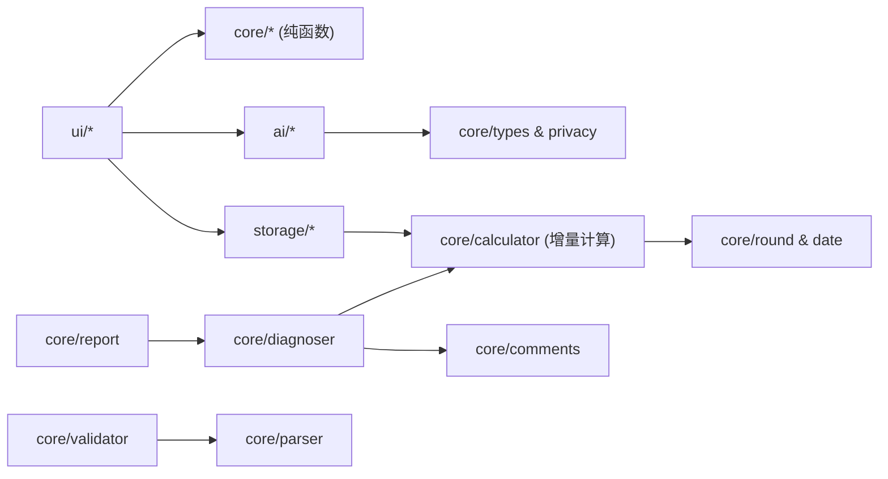
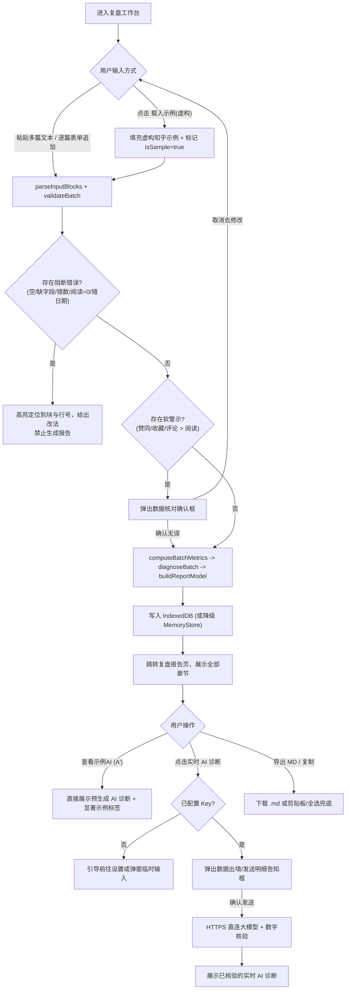

# 阶段二：详细设计 —— 知乎回答数据复盘助手

> 文档版本：v1.0（2026-11-25，UTC+8）
> 依据：`BRIEF.md`、`docs/01-feasibility-architecture.md` 及用户对 D1–D7 的拍板决策
> 范围：只做阶段二（详细设计），**不开始阶段三代码实现**。文中类型签名采用 JSDoc 规范，算法用步骤与规格表达，不编写产品源码文件。

---

## 0. 阶段二验收标准与 D1–D7 决策落实

### 0.1 D1–D7 决策逐条映射

| 决策项 | 用户拍板 | 本文设计落实位置 |
|---|---|---|
| **D1** | 采用**方案②相对诊断**，放弃绝对阈值 | §3.2 相对诊断规则、§4.2 报告模板口径声明 |
| **D2** | 采用 **A′ 方案**：内置示例数据配预先生成的 AI 诊断（明确标注“预先生成示例输出，非实时”）+ BYOK 用户自备 Key 实时诊断 | §6.5 内置示例设计、§7 AI 深度诊断设计 |
| **D3** | 默认不做 OAuth，除非 2026-11-28 前收到官方凭证与文档；说明书如实写数据由用户主动粘贴 | §1.1 模块边界（无 OAuth/后端模块）、§1.3 预留扩展点说明 |
| **D4** | 一致性回归**只覆盖计算结果**（数字解析、比率、合计、排名、跨度、收赞比）；诊断文案与评论分类按知乎语境重做，不要求与 oracle 一致 | §2.4 Q1–Q11 兼容矩阵、§8.2 差分与回归测试计划 |
| **D5** | 解析器容忍 `'点赞'`（及 `'赞'`）作为输入别名，静默映射为 `赞同` 并给出非阻断提示；**界面与报告文案中绝不出现 `'点赞'` 二字** | §2.1 别名表、§2.5 提示文案（提示语本身亦不含禁词）、§4.4 禁词扫描白名单 |
| **D6** | 在阶段五提交文档（`docs/04-submission.md`）中如实声明团队此前曾做过其他平台的复盘类 Skill，不写具体平台名称 | §4.4 原创性防线与阶段五衔接提示 |
| **D7** | 若 GitHub Pages 与 Netlify 在大陆均不可用，允许启用“自定义域名 + Cloudflare”作为保底方案 | §6.4 部署与外链/CSP 兼容设计 |

### 0.2 阶段二验收标准自查索引（对应阶段一 §10）

| # | 阶段二验收项 | 本文位置 |
|---|---|---|
| S2-1 | D1–D7 全部有决定，并体现在设计中 | §0.1 + 全文 |
| S2-2 | 模块设计：每个模块的职责、输入输出、依赖；纯函数模块的函数签名（含 JSDoc 类型） | §1 |
| S2-3 | 解析规格：完整别名表、数字与日期格式表、每类错误的中文提示文案；明确 Q1–Q11 逐条如何实现 | §2 |
| S2-4 | 诊断规格：相对诊断阈值、小样本阈值、数据龄规则、四个角色判定算法与并列处理、评论五类关键词库与优先级、改进清单生成规则（含 4 要素、三档优先级、最多 5 条） | §3 |
| S2-5 | 数据模型与本地存储设计：IndexedDB 库/表/索引、版本迁移策略、降级策略、备份文件格式 | §5 |
| S2-6 | UI 设计：页面结构、交互流程图、空态/错误态/加载态、移动端布局、视觉要点；全部用户可见文案为简体中文且不含禁用词 | §6 |
| S2-7 | 报告模板全文（新写），附“与原 Skill 措辞对照表”，相同句子为 0 | §4.2–§4.3 |
| S2-8 | AI 设计（D2 选 A′）：提示词设计、发送字段清单、告知文案、错误分类与提示、数字校验方法；并附真实调用人工验证规程（由用户持自有 Key 操作，Key 不入仓库） | §7 |
| S2-9 | 测试计划：单元/差分/端到端/手工测试清单，与阶段三、四验收项一一对应 | §8 |

---

## 1. 总体架构与模块设计

### 1.1 技术栈最终拍板与目录结构

- **语言与类型**：原生 JavaScript（ES Modules）+ JSDoc 类型注释 + `// @ts-check`（通过 `tsc --noEmit --allowJs --checkJs` 静态类型检查，零构建期语法转译负担）。
- **界面方案拍板**：阶段一提出“原生 DOM + 轻量模板函数，若状态复杂切 Preact”。经本阶段梳理，应用共 4 个视图、单向数据流（输入 → 解析校验 → 计算诊断 → 渲染/存储），无深层嵌套双向绑定需求；**维持原生 DOM + 轻量安全模板函数（`el()` / `escapeHtml()`）**，零 UI 框架运行时体积，更容易把 gzip 包体控制在 100 KB 以内（远低于 200 KB 目标），利于大陆首屏加载。
- **构建与依赖**：Vite + 零运行时外部依赖（`IndexedDB` 采用约 120 行的自写 Promise 薄封装 `storage/idb.js`，避免连 `idb` 也不必引入，使运行时第三方依赖为 **0**，进一步消除供应链与体积风险）。

规划仓库目录结构（阶段三按此落盘）：

```text
zhihu-hackathon-s3/
├── .github/workflows/ci-deploy.yml   # 测试 + 禁词/凭证扫描 + 构建 + GitHub Pages 发布
├── index.html                        # 单页入口（含 CSP meta 与内置挂载点）
├── vite.config.js
├── jsconfig.json                     # 开启 checkJs
├── package.json                      # 仅 devDependencies: vite, vitest, playwright, typescript
├── scripts/
│   └── lint-guard.mjs                # 禁词扫描 + 凭证模式扫描 + reference/ 存在性检查
├── src/
│   ├── main.js                       # 应用启动、存储探测、路由与事件总线
│   ├── types.js                      # 全局 JSDoc @typedef 定义
│   ├── core/                         # 【纯函数核心】无 DOM / 无存储 / 无网络
│   │   ├── round.js                  # Q1/Q2 精确十进制格式化与半偶舍入
│   │   ├── date.js                   # Q4 墙钟日期解析与整天差计算
│   │   ├── parser.js                 # 块切分、标签别名解析、数字解析、隐私打码
│   │   ├── validator.js              # 阻断错误、软警示、别名提示、不足3篇检查
│   │   ├── calculator.js             # 比率、合计、排名、跨度、收赞比、增量计算
│   │   ├── comments.js               # 知乎五类评论分类器
│   │   ├── diagnoser.js              # 相对诊断、数据龄、小样本、四角色、改进清单
│   │   ├── report.js                 # ReportModel 构建与 Markdown 序列化
│   │   └── zhihu-sample.js           # 内置知乎虚构示例文本 + A′ 预生成 AI 示例结果
│   ├── storage/                      # 【本地持久化层】
│   │   ├── idb.js                    # IndexedDB 薄封装与降级 MemoryStore
│   │   ├── review-store.js           # Review / AnswerIndex 读写与跨期增量查询
│   │   ├── settings-store.js         # localStorage 设置 + sessionStorage/localStorage Key 管理
│   │   └── backup.js                 # JSON 备份导出/校验/导入 + Markdown 下载/复制兜底
│   ├── ai/                           # 【AI 深度诊断适配器（D2 A′）】
│   │   ├── providers.js              # DeepSeek / Moonshot / 通义 / OpenAI 端点与默认模型配置
│   │   ├── prompt.js                 # 脱敏载荷构造与提示词拼装
│   │   ├── client.js                 # OpenAI 兼容 fetch 调用、AbortController 超时与错误分类
│   │   └── verifier.js               # AI 输出引用数字核验器
│   └── ui/                           # 【视图层】纯文本转义渲染，防 XSS
│       ├── dom.js                    # el()、escapeHtml()、toast、modal 基础件
│       ├── app-shell.js              # 顶栏导航、降级横幅、状态管理
│       ├── workspace-view.js         # 输入工作台（粘贴区、逐篇辅助录入、截至时间、载入示例）
│       ├── report-view.js            # 复盘报告渲染、导出按钮组、AI 诊断面板
│       ├── history-view.js           # 历史记录列表、单回答跨期增量对比、删除
│       ├── settings-view.js          # 规则参数设置、BYOK 配置、JSON 备份导入导出
│       └── styles.css                # 响应式样式（375px 移动优先适配）
└── tests/
    ├── fixtures/
    │   ├── oracle-zhihu.txt          # 由原数值改编为知乎字段名的回归固件（仅测试用）
    │   ├── oracle-expected.json      # 固化纯数字期望结果（含 35 万差分用例生成种子或快照）
    │   └── comment-corpus.json       # 每类 ≥ 10 条知乎评论分类测试语料
    ├── unit/                         # parser / round / calculator / comments / diagnoser / report / store / ai-verifier
    ├── regression/                   # oracle-parity.test.js + differential-350k.test.js
    └── e2e/                          # playwright 核心流程（桌面 + 375px 移动）
```

### 1.2 模块职责与依赖矩阵



| 模块 | 职责 | 输入 | 输出 | 依赖 |
|---|---|---|---|---|
| `core/round.js` | 与 Python 逐字一致的半偶舍入与百分比格式化 | `number \| null` | `number` / `string` | 无 |
| `core/date.js` | 墙钟日期解析、日期格式校验、UTC 整天差与数据龄计算 | 日期字符串 / UTC 毫秒 | `ParsedDate \| null` / 整天数 | 无 |
| `core/parser.js` | 文本分块、别名映射（含 D5）、数字解析、评论区提取与隐私打码 | 原始粘贴文本、选项 | `ParseResult`（含块级/行级定位） | `round.js`, `date.js` |
| `core/validator.js` | 阻断问题检查、软警示（如赞同>阅读）、样本数<3判定 | `ParseResult`, `Settings` | `ValidationResult` | `parser.js` |
| `core/calculator.js` | 比率、合计、加权均值、稳定排名、跨度、收赞比、跨期增量 | `AnswerInput[]`, `asOfUtcMs` | `BatchMetrics` | `round.js`, `date.js` |
| `core/comments.js` | 知乎五类评论分类、计数、隐私脱敏 | 评论字符串数组 | `CommentAnalysis` | 无 |
| `core/diagnoser.js` | 相对诊断、数据龄降级、小样本限制、四角色、行动清单（≤5条） | `BatchMetrics`, `HistoryBaseline \| null`, `Settings` | `DiagnosisResult` | `calculator.js`, `comments.js`, `round.js` |
| `core/report.js` | 组装唯一 `ReportModel` 并序列化为 Markdown 与下次模板 | `BatchMetrics`, `DiagnosisResult`, `ReviewMeta` | `ReportModel`, `string` | `round.js`, `date.js` |
| `storage/idb.js` | IndexedDB 打开/迁移/CRUD，不可用时自动降级 `MemoryStore` | 库名、Store 名、记录 | `Promise<T>` + `degraded` 标志 | 浏览器 IndexedDB |
| `storage/review-store.js` | 复盘存档、按“规范化标题+发布日期”检索同名历史快照与计算增量 | `ReviewRecord` | 历史列表、基线中位数、跨期增量 | `idb.js`, `calculator.js` |
| `storage/settings-store.js` | 规则设置（`localStorage`）与 AI Key（默认 `sessionStorage`）读写 | `Settings`, `AiKeyConfig` | `Settings` | Web Storage |
| `storage/backup.js` | JSON 备份生成与校验导入、Markdown 文件下载与剪贴板兜底 | `ReviewRecord[]` / `string` | `Blob` / 导入结果 | `review-store.js` |
| `ai/*` | 脱敏载荷构造、OpenAI 兼容直连、错误分类、输出数字核验 | `ReportModel`, `AiConfig` | `AiDiagnosisResult` | `core/round.js` |
| `ui/*` | 4 个页面视图、表单辅助输入、确认弹窗、响应式渲染 | 用户操作 + State | DOM 更新 | 全部上层模块 |

### 1.3 预留扩展点（对应 D3）

- `workspace-view.js` 的数据导入区只暴露“粘贴文本”和“逐篇填写表单”两个入口，不耦合任何远程抓数或 OAuth 逻辑。
- 若 2026-11-28 前用户收到知乎开放平台凭证及文档并通过阶段一 §3.5 闸门，可在 `src/importer/` 下新增适配器，将其输出统一转为标准 `AnswerInput[]` 交给 `calculator.js`，不影响核心计算与报告链路。

### 1.4 纯函数模块 JSDoc 类型与函数签名

#### `src/types.js`（核心数据结构）

```js
/**
 * @typedef {'upvotes'|'views'|'collects'|'comments'|'endorseLikes'|'shares'|'title'|'published'|'categoryTag'} CanonicalField
 *
 * @typedef {Object} ParseIssue
 * @property {'error'|'warning'|'notice'} severity
 * @property {string} code
 * @property {number} blockIndex        // 从 1 开始
 * @property {number} startLine         // 块起始行（从 1 开始）
 * @property {number} line              // 触发问题的具体行号
 * @property {string} [fieldLabel]      // 原始标签文本
 * @property {string} message           // 面向用户的简体中文说明
 * @property {string} [fixHint]         // 具体修改建议
 *
 * @typedef {Object} ParsedAnswer
 * @property {number} blockIndex
 * @property {number} startLine
 * @property {string} title
 * @property {string} publishedRaw
 * @property {number|null} publishedUtcMs
 * @property {string|null} publishedDateStr   // 'YYYY-MM-DD'
 * @property {number} views
 * @property {number} upvotes
 * @property {number} collects
 * @property {number} comments
 * @property {number|null} endorseLikes
 * @property {number|null} shares
 * @property {string|null} categoryTag        // 如 '干货'|'观点'|'经历'|'测评'|string
 * @property {string[]} commentsText          // 原文（仅内存，不持久化展示用）
 * @property {string[]} maskedCommentsText    // 已做手机号/邮箱/证件号/@用户名脱敏
 *
 * @typedef {Object} ParseResult
 * @property {ParsedAnswer[]} items
 * @property {ParseIssue[]} blockingErrors
 * @property {ParseIssue[]} warnings
 * @property {ParseIssue[]} notices
 * @property {number} totalBlocks
 *
 * @typedef {Object} AnswerMetrics
 * @property {ParsedAnswer} raw
 * @property {number|null} upvoteRate         // upvotes / views * 100
 * @property {number|null} collectRate        // collects / views * 100
 * @property {number|null} commentRate        // comments / views * 100
 * @property {number|null} engagementRate     // (upvotes+collects+comments)/views*100
 * @property {number|null} collectUpvoteRatio // collects / upvotes
 * @property {number|null} ageDays            // floor((asOfUtcMs - publishedUtcMs)/86400000)
 * @property {boolean} isSmallSample          // views < smallSampleThreshold
 * @property {boolean} isImmature             // ageDays !== null && ageDays < ageThresholdDays
 * @property {number} rank                    // 1-based，按 engagementRate 稳定降序
 *
 * @typedef {Object} BatchMetrics
 * @property {number} asOfUtcMs
 * @property {string} asOfDisplay             // 'YYYY-MM-DD HH:mm'
 * @property {AnswerMetrics[]} items          // 保持输入顺序
 * @property {AnswerMetrics[]} ranked         // 按互动率降序（views=0 排末尾）
 * @property {{views:number, upvotes:number, collects:number, comments:number, interactions:number, endorseLikes:number, shares:number}} totals
 * @property {number|null} weightedEngagementRate
 * @property {{upvoteRate:number|null, collectRate:number|null, commentRate:number|null, engagementRate:number|null}} medians
 * @property {{spanDays:number|null, earliestDate:string|null, latestDate:string|null, minAgeDays:number|null, maxAgeDays:number|null, hasLargeAgeSpread:boolean}} timeSpan
 *
 * @typedef {'question_doubt'|'follow_up'|'urge_update'|'bookmark_mark'|'endorsement'|'unclassified'} CommentCategory
 *
 * @typedef {Object} Settings
 * @property {number} ageThresholdDays        // 默认 7，可选 3|7|14|30
 * @property {number} smallSampleThreshold    // 默认 200
 * @property {boolean} maskMentionHandles     // 默认 true（@用户名脱敏）
 * @property {string} aiProviderId            // 默认 'deepseek'
 * @property {string} aiModel
 * @property {boolean} rememberApiKey         // 默认 false（仅 sessionStorage）
 */
```

#### 核心纯函数签名清单

```js
// core/round.js
/** @param {number} value @returns {number} */
export function roundHalfEvenInt(value) {}

/** @param {number|null} value @param {number} [digits=2] @returns {string} */
export function formatFixedHalfEven(value, digits = 2) {}

/** @param {number|null} value @returns {string} */
export function formatPercent(value) {}

// core/date.js
/** @param {string} text @returns {{utcMs:number, dateStr:string, hasTime:boolean}|null} */
export function parseWallDate(text) {}

/** @param {number} earlierUtcMs @param {number} laterUtcMs @returns {number} */
export function diffDaysFloor(earlierUtcMs, laterUtcMs) {}

/** @param {number} utcMs @returns {string} */
export function formatUtcMinute(utcMs) {}

// core/parser.js
/** @param {string} text @returns {number} throws Error with Chinese message on invalid */
export function parseZhihuNumber(text) {}

/** @param {string} text @returns {string} */
export function maskSensitiveText(text, maskHandles = true) {}

/**
 * @param {string} rawText
 * @param {{oracleCompat?:boolean, maskHandles?:boolean}} [options]
 * @returns {ParseResult}
 */
export function parseInputBlocks(rawText, options = {}) {}

// core/validator.js
/**
 * @param {ParseResult} parseResult
 * @param {Settings} settings
 * @returns {{canGenerate:boolean, needsConfirmation:boolean, canRank:boolean, blockingErrors:ParseIssue[], softWarnings:ParseIssue[], notices:ParseIssue[]}}
 */
export function validateBatch(parseResult, settings) {}

// core/calculator.js
/** @param {number} part @param {number} whole @returns {number|null} */
export function calcRate(part, whole) {}

/**
 * @param {ParsedAnswer[]} items
 * @param {{asOfUtcMs:number, settings:Settings}} options
 * @returns {BatchMetrics}
 */
export function computeBatchMetrics(items, options) {}

/**
 * @param {ParsedAnswer} prevSnapshot
 * @param {ParsedAnswer} currSnapshot
 * @returns {{viewsDelta:number, upvotesDelta:number, collectsDelta:number, commentsDelta:number, incrementalEngagementRate:number|null, hasAnomaly:boolean}}
 */
export function computeAnswerDelta(prevSnapshot, currSnapshot) {}

// core/comments.js
/** @param {string} commentText @returns {CommentCategory} */
export function classifyZhihuComment(commentText) {}

/** @param {string[]} comments @returns {{total:number, counts:Record<CommentCategory, number>, items:Array<{text:string, category:CommentCategory}>}} */
export function analyzeComments(comments) {}

// core/diagnoser.js
/**
 * @param {BatchMetrics} metrics
 * @param {{medianEngagementRate:number|null, medianUpvoteRate:number|null, medianCollectRate:number|null, medianCommentRate:number|null, sampleCount:number}|null} historyBaseline
 * @param {Settings} settings
 * @returns {DiagnosisResult}
 */
export function diagnoseBatch(metrics, historyBaseline, settings) {}

// core/report.js
/**
 * @param {BatchMetrics} metrics
 * @param {DiagnosisResult} diagnosis
 * @param {{reviewId:string, createdAtUtcMs:number, engineVersion:string, isSample:boolean, deltas:Array<object>, aiDiagnosis:AiDiagnosisResult|null}} meta
 * @returns {ReportModel}
 */
export function buildReportModel(metrics, diagnosis, meta) {}

/** @param {ReportModel} model @returns {string} */
export function serializeReportToMarkdown(model) {}
```

---

## 2. 解析与校验规格

### 2.1 完整输入字段别名表

块分隔符：空行（`^\s*$`）或独立分隔行 `---`、`***`、`===`。
标签行匹配正则（Q7）：`^([^：:]{1,12})[：:]\s*(.+)$`，按第一个中/英文冒号切分，使问题标题自带的冒号（如 `如何评价：……`）完整保留。

| 内部字段 | 必填 | 知乎标准标签与别名 | 特殊说明 |
|---|---|---|---|
| `title` | 是 | `标题`、`题目`、`问题`、`问题标题`、`回答标题`、`回答` | 保留原样用于展示；另派生规范化键用于跨期匹配（§5.4） |
| `published` | 是 | `发布时间`、`发布日期`、`发布`、`日期` | 支持格式见 §2.2 |
| `views` | 是 | `阅读量`、`阅读`、`阅读数`、`浏览量`、`浏览` | 禁止为 0（界面阻断，oracle 模式按 -1 排序） |
| `upvotes` | 是 | `赞同`、`赞同数`、`获赞同`、`点赞`*(D5白名单)*、`赞`*(D5白名单)* | 命中 `'点赞'` 或 `'赞'` 时触发 D5 非阻断提示（§2.5），**提示文案及界面不出现“点赞”二字** |
| `collects` | 是 | `收藏`、`收藏数` | 整数 ≥ 0 |
| `comments` | 是 | `评论`、`评论数` | 整数 ≥ 0 |
| `endorseLikes` | 否 | `喜欢`、`喜欢数` | 解析后单独展示，**不进入互动率与排名**（Q9） |
| `shares` | 否 | `分享`、`分享数` | 解析后单独展示，**不进入互动率与排名**（Q9） |
| `categoryTag` | 否 | `类型`、`回答类型`、`分类`、`标签` | 可选，用于“同类型参考标注”；不填不影响任何流程 |
| 评论区起止 | 否 | `代表性评论[：:]`、`评论示例[：:]`、`典型评论[：:]` | 触发后该块后续行均为评论（Q6），忽略开头的 `- `、`• `、`· ` |

> 注：为保证 `oracle-zhihu.txt` 与旧测试兼容性，解析器不把原平台特定名词纳入公开推荐格式；如仅为了与 D5 保持一致，内部别名表仅白名单保留 `'点赞'` 和 `'赞'`。

### 2.2 数字与日期格式规格

#### 数字格式（`parseZhihuNumber`）

1. 预处理：去首尾空白，移除半角 `,` 与全角 `，`。
2. 允许正则：`^([0-9]+(?:\.[0-9]+)?)\s*(万|千)?$`。
3. 换算：`万` × 10000；`千` × 1000；结果经 `roundHalfEvenInt` 半偶舍入取整。
4. 合法示例：`0` → 0，`18200` → 18200，`18,200` → 18200，`18，200` → 18200，`1.2万` → 12000，`3千` → 3000，`1.25千` → 1250（`12.5` → 12，`13.5` → 14）。
5. 明确拒收并报错的写法：
   - 模糊量级：`10万+`、`1.2w`、`1k`、`约2万` → 报错提示“不支持模糊估算或英文简写单位（如‘10万+’、‘1.2w’），请改为精确数字或使用‘万/千’”。
   - 负数或非数字：`-5`、`暂无`、`--` → 报错提示“数值必须为非负数字，可带千分位逗号或‘万/千’单位”。
   - 超过 JS 安全整数边界（`> 9e15`）→ 报错提示“数字超出合理范围，请核对是否误贴”。

#### 日期格式（`parseWallDate`）

严格支持以下 5 种墙钟格式（与 `review.py` 一致，另做真实日历日期合法性校验，如拒绝 `2026-02-30`）：

| 格式 | 正则与示例 | 说明 |
|---|---|---|
| `YYYY-MM-DD HH:mm` | `2026-11-16 12:00` | 推荐格式 |
| `YYYY-MM-DD HH:mm:ss` | `2026-11-16 12:00:30` | 保留秒精度用于计算数据龄 |
| `YYYY-MM-DD` | `2026-11-16` | 时分秒按 `00:00:00` 计 |
| `YYYY/MM/DD HH:mm` | `2026/11/16 12:00` | 兼容斜杠分隔 |
| `YYYY/MM/DD` | `2026/11/16` | 时分秒按 `00:00:00` 计 |

> 对月/日允许单双位或仅严格两位？为与 Python `%Y-%m-%d` 严谨对齐并兼容常见粘贴：`YYYY-M-D` 亦可在校验真实年月日后转为 UTC 墙钟，而**无年份写法**（如 `11-16`）或**相对时间**（如 `昨天 12:00`、`3 小时前`）无法确定准确发布年份或精确时刻，在 UI 校验阶段给出清晰报错，要求补全年份（如 `2026-11-16`）。

### 2.3 隐私打码规则（`maskSensitiveText`）

评论展示、本地持久化报告摘要以及发送给 AI 前，统一对代表性评论执行正则脱敏：

| 敏感信息 | 匹配规则 | 替换结果 |
|---|---|---|
| 中国大陆手机号 | `(?<!\d)(1[3-9]\d)(\d{4})(\d{4})(?!\d)` | `$1****$3` |
| 邮箱地址 | `([a-zA-Z0-9._%+-]{1,2})[a-zA-Z0-9._%+-]*(@[a-zA-Z0-9.-]+\.[a-zA-Z]{2,})` | `$1***$2` |
| 身份证号（15/18位） | `(?<!\d)([1-9]\d{3})\d{7,10}(\d{3}[\dXx])(?!\d)` | `$1********$2` |
| `@用户昵称`（默认开启，设置可调） | `@([^\s:：,，。!！?？/()（）]{1,24})` | `@[用户]` |

### 2.4 Oracle 兼容行为（Q1–Q11）逐条实现规格

| 编号 | Oracle 行为 | 阶段三 JS 实现方式 |
|---|---|---|
| **Q1** | 比率格式化 `f"{x:.2f}"` 对精确 double 做半偶舍入 | `formatFixedHalfEven(x, 2)`：处理正负号；对 `Math.abs(x) < 1e21` 调用 `.toFixed(100)` 获取精确十进制字符串，切分 `ip`（整数部分）、`keep`（前 2 位小数）、`rest`（第 3 位起小数）；按 `rest[0]` 与 `5` 比较及后续非零位判断，平局时检查保留末位奇偶性，使用 `BigInt` 进位拼接。非有限数或超界返回兜底格式。 |
| **Q2** | `int(round(v))` 银行家舍入 | `roundHalfEvenInt(v)`：取 `f = Math.floor(v)`，`d = v - f`；`d > 0.5` 返回 `f + 1`，`d < 0.5` 返回 `f`，`d === 0.5` 时 `f % 2 === 0 ? f : f + 1`（负值对称处理）。 |
| **Q3** | 比率计算顺序 `part / whole * 100.0` | `calcRate(part, whole)` 严格先执行 `part / whole`，再 `* 100`；`whole === 0` 返回 `null`。严禁改写为 `(part * 100) / whole`。 |
| **Q4** | 时间跨度 `(max - min).days` 整天向下取整（含时分） | 所有日期用 `Date.UTC(y, m - 1, d, hh, mm, ss)` 构造墙钟毫秒数，`diffDaysFloor` 计算 `Math.floor((maxMs - minMs) / 86400000)`，完全不受本地时区与夏令时影响。 |
| **Q5** | 稳定降序排列，阅读 0 按 `-1` 排最后；`max()` 并列取首项 | `ranked = [...items].sort((a, b) => (b.engagementRate ?? -1) - (a.engagementRate ?? -1))`（ES2019+ 保证稳定排序）。取最高阅读量时用严格 `>` 从头遍历，并列取先出现者。 |
| **Q6** | `代表性评论：` 后该块其余行全作评论 | `parser.js` 状态机进入 `inCommentSection = true` 后，直到块结束才复位；UI 在用户粘贴超过 5 条时仅给非阻断提示“第 X 篇粘贴了 N 条评论，建议控制在 5 条代表性评论以内”，但计算/分类不丢弃，保证与 Q6 一致。 |
| **Q7** | `^([^：:]{1,12})[：:]\s*(.+)$` 首冒号切分 | 原样使用该正则；未匹配到已知别名的非空行记入 `notices`（不静默吞错）。 |
| **Q8** | 缺字段/解析失败块在 CLI 中跳过并告警 | `parseInputBlocks(text, { oracleCompat: true })` 跳过无效块并产出 `warnings`（供单元测试验证 Q8）；UI 流程通过 `validateBatch` 将其升级为阻断错误并精准指出块号与行号，阻止生成错误报告。 |
| **Q9** | `分享` 可选，解析但不入比率 | `shares` 与知乎 `endorseLikes`（喜欢）均解析并保留在 `totals` 与总览可选列中，不参与 `interactions` 累加与任何比率。 |
| **Q10** | 原别名表不含 `赞同` | 扩展知乎标准别名（§2.1），同时通过 D5 保留 `'点赞'/'赞'` 别名并触发非阻断提示。 |
| **Q11** | 校验与数量/数据龄由外部规则承担 | 在 `validator.js` 与 `diagnoser.js` 中全部确定性规则化（§2.5、§3），不依赖口头约定。 |

### 2.5 各类错误的简体中文提示文案表

> 严格检查：下表所有面向用户的文案均**不含“小红书 / 笔记 / 封面 / 点赞”字样**。

| 分类 | 触发条件 | 级别 | 简体中文提示文案模板 | 修复指引文案 |
|---|---|---|---|---|
| 空输入 | 输入框去除空白后为空 | 阻断 | `尚未检测到回答数据。请粘贴至少 1 篇（建议 3 篇以上）回答数据，或点击“载入示例”快速体验。` | `可直接使用右侧“逐篇添加”表单或按模板粘贴。` |
| 缺问题标题 | 某块未解析出 `title` | 阻断 | `第 {blockIndex} 篇（第 {startLine} 行附近）：缺少问题标题，无法识别该篇回答。` | `请在该块开头补充一行“标题：你的问题标题”。` |
| 缺必填字段 | 缺 `published`/`views`/`upvotes`/`collects`/`comments` 任一项 | 阻断 | `第 {blockIndex} 篇《{title}》（第 {startLine} 行）：缺少必填项【{missingFields中文列表}】。` | `请补全上述字段后再生成报告；若某项为 0，请明确填写“0”。` |
| 数字格式非法 | `parseZhihuNumber` 失败 | 阻断 | `第 {blockIndex} 篇《{title}》第 {line} 行：【{fieldName}】的数值“{rawValue}”无法识别。` | `请改为非负整数或“1.2万 / 3千 / 18,200”格式，勿填写“10万+”或“1.2w”等估算值。` |
| 阅读量为 0 | `views === 0` | 阻断 | `第 {blockIndex} 篇《{title}》第 {line} 行：阅读量为 0，无法作为比率分母。` | `请核对创作中心数据；刚发布暂无阅读量的回答建议先不纳入对比。` |
| 日期格式非法 | `parseWallDate` 返回 `null` | 阻断 | `第 {blockIndex} 篇《{title}》第 {line} 行：发布时间“{rawValue}”无法解析。` | `请使用“YYYY-MM-DD HH:mm”或“YYYY-MM-DD”格式（例如 2026-11-16 12:00），暂不支持无年份或相对时间。` |
| 未知字段行 | 块内存在非评论区但无法识别的 `标签：值` | 非阻断提示 | `第 {blockIndex} 篇《{title}》第 {line} 行：未识别字段“{label}”，已忽略。` | `若为笔误，请对照支持标签名修改。` |
| D5 别名映射 | 块内使用非知乎标准词（`'点赞'`/`'赞'`）映射至 `赞同` | 非阻断提示 | `第 {blockIndex} 篇《{title}》第 {line} 行：检测到非知乎标准字段名，已自动按“赞同”口径计算。` | `建议后续记录时直接写“赞同：数值”。` |
| 互动数异常大 | `upvotes > views` 或 `collects > views` 或 `comments > views` | 软警示（需确认） | `第 {blockIndex} 篇《{title}》：【{fieldName}】({value}) 大于阅读量 ({views})，这在常规统计中较为少见。` | `请确认是否将其他字段误填为阅读量；如确认无误可点击“确认数据无误，继续生成”。` |
| 篇数不足 3 篇 | `1 <= items.length < 3` | 状态降级（可生成基础表） | `当前仅录入 {count} 篇回答（少于 3 篇）：已为你计算各篇基础比率，暂不生成互动率排名与横向对比诊断。` | `建议再补充至少 {3 - count} 篇回答后重新生成完整复盘。` |
| 数据截至时间早于发布时间 | `asOfUtcMs < publishedUtcMs` | 阻断 | `第 {blockIndex} 篇《{title}》的发布时间晚于当前“数据截至时间”（{asOfDisplay}）。` | `请将顶部“数据截至时间”调整为实际抄录数据的时刻，或检查发布时间年份。` |

### 2.6 粘贴格式与逐篇表单辅助（应对阶段一 R6）

为降低手工粘贴格式出错率，工作台在文本粘贴框旁提供**“逐篇添加助手”折叠表单**：
- 字段：问题标题、发布时间（日期时间选择器，自动格式化为 `YYYY-MM-DD HH:mm`）、阅读、赞同、收藏、评论、回答类型（可选下拉：干货/观点/经历/测评）、代表性评论（多行，自动补 `- `）。
- 点击“加入待复盘文本”后，直接按标准块格式追加到主文本框中。**计算链路仍然只有一条（文本 → 解析器）**，不制造第二套数据源，兼顾快捷粘贴与零格式错误。

---

## 3. 确定性计算与相对诊断规格

### 3.1 计算公式与中位数口径

所有指标均按以下公式计算（使用未舍入双精度浮点进行后续中位数与倍数计算，仅在展示层调用 `formatPercent` / `formatFixedHalfEven`）：

1. `赞同率 = 赞同 ÷ 阅读 × 100%`（`calcRate(upvotes, views)`）
2. `收藏率 = 收藏 ÷ 阅读 × 100%`（`calcRate(collects, views)`）
3. `评论率 = 评论 ÷ 阅读 × 100%`（`calcRate(comments, views)`）
4. `互动率 = (赞同 + 收藏 + 评论) ÷ 阅读 × 100%`
5. `收赞比 = 收藏 ÷ 赞同`（赞同为 0 时为 `null`，显示 `—`）
6. `批次加权平均互动率 = 总互动 ÷ 总阅读 × 100%`（注：不是各篇简单平均）
7. `中位数 median(values)`：忽略 `null`，升序排列；奇数取中间值，偶数取中间两项算术平均 `(a + b) / 2`。

### 3.2 相对诊断规则（D1 落实）

放弃任何绝对及格线，所有评价围绕四个参照系展开：

1. **批内中位数倍数（必选，≥ 3 篇时生效）**：
   对每篇的 4 个比率分别计算 `ratioToMedian = answerRate / batchMedianRate`（分母为 `0` 或 `null` 时不计算倍数）：
   - `ratioToMedian >= 1.50` → 档位 `high`（文案：“明显高于本批中位数，为中位数的 X.XX 倍”）
   - `0.67 < ratioToMedian < 1.50` → 档位 `normal`（文案：“与本批中位水平接近，为中位数的 X.XX 倍”）
   - `ratioToMedian <= 0.67` → 档位 `low`（文案：“明显低于本批中位数，仅为中位数的 X.XX 倍”）
   > 以上 1.50 / 0.67 倍为本工具约定的相对显著偏离阈值，**非知乎官方标准**，报告中显式声明。

2. **收赞比结构信号**：
   - `collectUpvoteRatio >= 1.0` → 干货/工具属性强（“收藏多于赞同，读者倾向留存复用”）。
   - `collectUpvoteRatio < 0.5` 且赞同率高于中位数 → 观点/共鸣/情绪表达属性强（“读者愿意公开赞同表态，但留存需求偏弱”）。

3. **个人历史基线对照（自动启用，条件：本地历史去重后累计 ≥ 10 篇有效回答）**：
   - 从 IndexedDB `answerIndex` 取每个历史回答最新一次快照的比率，计算个人历史中位数 `historyMedian`。
   - 对本批加权平均互动率与关键分项给出“较你过去 N 篇的历史中位数（X.XX%）高/低 X.XX 个百分点”。
   - 若用户为某篇填写了可选 `categoryTag`（如“干货”），且本地历史中该同类型回答 ≥ 5 篇，额外展示一行“同类型（干货）历史中位参考：X.XX%”；不足 5 篇则仅展示标签，不做强制对比。

4. **小样本与数据龄约束**：
   - **小样本阈值**：`views < settings.smallSampleThreshold`（默认 **200**）。小样本回答**正常计算比率、正常参与互动率排名**，但：
     - 标记 `isSmallSample = true`，在总览表和排名中加徽标 `样本小（<200阅读）`。
     - 选拔“本期表现最优”与“本期标杆”时，**优先从非小样本回答中选取**；仅当全批所有回答均 `< 200` 阅读时，才从中选取并统一标注“全批均为小样本，比率波动大，仅供参考”。
   - **数据龄阈值**：`ageDays = diffDaysFloor(publishedUtcMs, asOfUtcMs)`；默认 `ageThresholdDays = 7`（设置中可改 `3 / 7 / 14 / 30` 天）。
     - 若 `ageDays < ageThresholdDays`，标记 `isImmature = true`（“首轮分发可能未结束，数据龄 X 天”），任何选中该篇的角色结论标题旁自动附加 `（数据龄不足，仅供参考）`。
   - **批内新旧差异提醒**：
     `hasLargeAgeSpread = (maxAge - minAge) > 7 && (minAge === 0 ? maxAge > 7 : maxAge / minAge > 2)`。
     为 `true` 时，在摘要与诊断顶部提示：“本批回答发布新旧跨度较大（数据龄 {minAge} 天至 {maxAge} 天），绝对阅读量不可直接横向对比，请重点观察各项比率与跨期增量。”

### 3.3 四个核心角色判定算法与并列处理

在有效回答数量 `N >= 3` 且至少存在 1 篇 `views > 0` 时执行以下确定性判定：

| 角色 | 目标定位 | 判定算法与优先级 | 并列处理与边界情况 |
|---|---|---|---|
| **1. 本期表现最优 (`best`)** | 综合互动表现第一名 | 候选池：优先取 `isSmallSample === false && engagementRate !== null`；若全为小样本，则退回所有 `engagementRate !== null`。在候选池中按 `engagementRate` 降序选第一名。 | 若存在多个与最高 `engagementRate`（按展示精度或精确值完全相等，判定容差 `< 1e-12`）并列的回答：取输入顺序第一篇为主卡展示，同时在证据行明确列出全部并列篇目（“与《…》并列第一”）。 |
| **2. 本期干货/标杆样本 (`benchmark`)** | 最值得复用写法的样本 | 按优先级依次匹配：<br>① 既有最高阅读量又为最高互动率（双冠标杆）；<br>② 若无双冠，在非小样本中找 `collectUpvoteRatio >= 1.0` 且 `collectRate` 最高者（知乎干货标杆）；<br>③ 若无 `collectUpvoteRatio >= 1.0`，取非小样本中 `collectRate` 最高者；<br>④ 若全批为小样本，按 `collectRate` 最高者取。 | 若与 `best` 为同一篇，标题合并说明“兼任本期综合最优与标杆样本”，避免机械重复；若按规则并列，按 `views` 降序再按输入顺序取首项，并注明并列篇目。 |
| **3. 本期最需警惕（互动洼地）(`worst`)** | 互动转化最弱的一篇 | 在所有 `engagementRate !== null` 的回答中按 `engagementRate` 升序选最后一名（与排序末尾一致）。 | 若全部回答互动率完全相等（全部并列），则不硬拆“最差”，改为输出“全批 {N} 篇互动率完全一致（{X}%），无明显洼地”。若仅末尾并列，取排在最后（或阅读量更大者优先警惕）并在说明中列出并列篇目。 |
| **4. 投入产出优先级最高（待优化主力）(`topOpportunity`)** | **最值得改的一篇**（知乎可随时编辑原回答） | 计算每篇的**潜在互动缺口**：<br>`gap = views * (medians.engagementRate - engagementRate) / 100`（全部用未舍入浮点计算）。<br>选出 `gap > 0` 中数值最大的一篇。 | 若并列（`gap` 差 `< 1e-6`），取 `views` 更大者；若全批均高于或等于中位数（无 `gap > 0`，例如偶数篇极端分布或全等），则退回选 `views` 最高且 `collectRate` 最低的一篇（若仍全等则置空并跳过该卡）。展示时保留算式：`阅读 {views} × (中位互动率 {med}% - 当前互动率 {cur}%) ≈ {round(gap)} 次潜在互动空间`。 |

### 3.4 知乎评论五类关键词库、优先级与分类规则

**判定优先级（从高到低，单条评论只归入最先命中的一类，确保总数可验算）**：
`1. question_doubt（质疑求证） > 2. follow_up（追问） > 3. urge_update（催更/蹲后续） > 4. bookmark_mark（收藏标记） > 5. endorsement（认可） > 6. unclassified（未分类）`

| 优先级 | 类别代码 | 中文类名 | 关键词 / 正则规则库（子串不区分大小写，正则按说明匹配） | 知乎语境诊断含义 |
|---|---|---|---|---|
| 1 | `question_doubt` | **质疑求证** | `来源`、`出处`、`数据呢`、`依据`、`参考文献`、`文献`、`证据`、`怎么证明`、`你确定`、`真的吗`、`假吧`、`胡说`、`扯`、`瞎说`、`误导`、`偷换概念`、`幸存者偏差`、`以偏概全`、`逻辑漏洞`、`片面`、`不敢苟同`、`恰饭`、`广告`、`软文`、`洗地`、`外行`、`胡扯`、`编的`、`一眼假`、正则 `/(有|拿).*数据/i`、`/(哪|什么).*来源/` | 知乎读者高度重视信源与逻辑自洽；出现质疑优先直接编辑原回答补充处、前提边界或纠偏 |
| 2 | `follow_up` | **追问** | `请问`、`怎么`、`如何`、`能不能`、`可以吗`、`行吗`、`有没有`、`哪款`、`哪个`、`哪里`、`多少`、`第几`、`求`、`能展开`、`展开说说`、`具体`、`细节`、`步骤`、`教程`、`模板`、`适合`、`怎么办`、`为啥`、`为什么`、`什么意思`、问号 `?` 或 `？`（仅在未命中“质疑求证”时生效） | 正文存在信息缺口或适用场景未覆盖；适合在原回答末尾增设“补充说明 / 常见追问”小节 |
| 3 | `urge_update` | **催更/蹲后续** | `蹲`、`插眼`、`踢我`、`踢一下`、`等后续`、`等更新`、`催更`、`求更`、`更了吗`、`还有下文吗`、`下一期`、`下篇`、`快更`、`坐等` | 读者对延伸话题有明确期待；可写成新回答并在原回答末尾放关联链接 |
| 4 | `bookmark_mark` | **收藏标记** | `已收藏`、`收藏了`、`先赞后看`、`赞了再看`、`马住`、`码住`、`马克`、`mark`、`先存`、`留着看`、`存下来`、`收藏夹` | 工具/干货属性验证；可保持清单/步骤结构并做系列化 |
| 5 | `endorsement` | **认可** | `说得好`、`讲得好`、`讲透了`、`写得好`、`透彻`、`受教`、`学到了`、`干货`、`专业`、`中肯`、`客观`、`赞同`、`同意`、`支持`、`确实`、`在理`、`深有同感`、`说到心坎`、`终于有人说`、`良心`、`硬核`、`牛`、`厉害` | 读者共鸣点或专业背书；提炼该段写法供下一篇复用 |
| 6 | `unclassified` | **未分类** | 以上均未命中（如纯表情、无明确意图短评） | 列入原评论核对清单，不强行归因 |

> 说明：规则引擎在报告中必须固定注明“评论分类基于关键词与优先级粗分，可能存在反讽或上下文误判，请结合下方脱敏原评论核对”。

### 3.5 改进清单生成规则（最多 5 条）

每条行动建议固定包含四个字段：`title`（问题定位，≤ 24 字）、`evidence`（必须含输入与计算数字）、`action`（知乎可执行的改法）、`priority`（三档严格命名为：**`立即编辑原回答`** / **`下一篇回答应用`** / **`记录观察`**）。

按以下确定性优先级管道生成候选建议，去重并按重要度排序后**截断至最多 5 条**（超出 5 条的仅在“记录观察”末条合并提及或提示总数，不超出 5 条上限）：

| 触发条件 | 建议档位 | 改法模板（全部为知乎原生态） |
|---|---|---|
| 任一篇存在 `质疑求证` 类评论（≥ 1 条） | **立即编辑原回答** | 针对质疑点（如信源/边界条件）直接在原回答对应段落补充来源说明或限定前提，并在评论区置顶回复已修订位置。 |
| 存在 `topOpportunity`（潜在互动缺口 > 0）且其低在收藏率或赞同率 | **立即编辑原回答** | 优化该回答首屏前 3 行（直接亮明核心结论与适用人群），补充结构化小标题或总结清单，承接已有高阅读流量。 |
| 任一篇存在 `追问` 类评论 ≥ 2 条（或占评论 ≥ 40%） | **立即编辑原回答** | 将评论区高频追问整理为“常见追问补充”追加到原回答末尾，降低新读者理解门槛。 |
| 存在高收藏高赞同的 `benchmark` 但其阅读量处于本批后半段 | **下一篇回答应用** | 保留该回答的干货拆解结构与实操清单写法，下一次选题优先挑正在上升期的热榜或高搜索意图问题，争取早占前排排序。 |
| 存在 `催更/蹲后续` 评论 ≥ 1 条 | **下一篇回答应用** | 围绕读者蹲守的延伸问题撰写新回答，并在原回答末尾附加互链卡片引导长尾流量互导。 |
| 存在高阅读低互动回答（阅读最高但互动率低于中位数）且无明显质疑 | **立即编辑原回答** | 检查首屏前几行与首图是否仅停留在“情绪吸睛”，在正文第一屏后补充可核验的数据/案例以留住流经读者；同时自查是否存在回答排序或排版过密问题。 |
| 批内存在 `isImmature`（数据龄不足）或 `hasLargeAgeSpread` | **记录观察** | 对数据龄不足 {ageThresholdDays} 天的回答先不作定论，隔 3–7 天重新抄录数据生成复盘，通过“跨期增量对比”观察长尾表现。 |
| 以上命中不足 3 条时的保底建议 | **记录观察** | 若出现某篇阅读量明显偏低，自查是否在问题下排序靠后、问题已过热度期或存在折叠提示；保持每周固定抄录一次数据形成个人基线。 |

---

## 4. 报告模型、新写报告模板与原创性措辞对照

### 4.1 单一 `ReportModel` 与序列化原则

- 界面渲染（`report-view.js`）与 Markdown 导出（`serializeReportToMarkdown`）严格消费同一个 `ReportModel` 对象，保证屏幕与导出文件数字 100% 一致。
- `ReportModel` 包含：`meta`、`summary`、`overviewRows`、`totals`、`formulasNote`、`rankingItems`、`ageAndSampleWarnings`、`roles`（`best`/`benchmark`/`worst`/`topOpportunity`）、`commentInsights`、`actions`（≤ 5）、`crossPeriodDeltas`、`nextTemplate`、`aiSection`（可选，包含 A′ 预生成标识或 BYOK 实时核验结果）。

### 4.2 全新编写的知乎报告模板全文（Markdown 导出态）

> 以下模板为 100% 原创知乎文案，**不含任何禁用词**，每个数字均配有对应算式或可验算来源。

```markdown
# 知乎回答表现复盘报告（<最早日期> 至 <最晚日期> · 共 <N> 篇）

> 数据截至时间：<YYYY-MM-DD HH:mm>｜引擎版本：<vX.Y.Z>｜口径声明：知乎官方未发布互动率绝对及格线，本报告采用“批内相对对照”与“本人历史对照”评估表现，所有“偏高/偏低”均相对于本批中位数或本人过往记录而言。
> （若为示例数据，加注一行：⚠️ 当前展示为【内置示例数据（虚构）】，仅用于演示复盘流程。）

## 核心摘要

本批 <N> 篇回答累计获得阅读 <总阅读>、赞同 <总赞同>、收藏 <总收藏>、评论 <总评论>，总互动 <总互动> 次，**加权平均互动率为 <平均互动率>%**（总互动 <总互动> ÷ 总阅读 <总阅读>）。（若 ≥ 3 篇：批内互动率中位数为 <中位互动率>%，最高与最低相差 <极差> 个百分点；若历史 ≥ 10 篇：较你过往 <H> 篇回答的历史中位数（<历史中位>%）<高出/低于> <差值> 个百分点。）

## 指标总览与计算口径

| 问题标题 | 发布时间 | 数据龄 | 阅读 | 赞同 | 收藏 | 评论 | 赞同率 | 收藏率 | 评论率 | 互动率 | 收赞比 |
| --- | --- | ---: | ---: | ---: | ---: | ---: | ---: | ---: | ---: | ---: | ---: |
| <标题> | <时间> | <X> 天 | <数> | <数> | <数> | <数> | <X.XX%> | <X.XX%> | <X.XX%> | <X.XX%> | <X.XX> |

- **汇总数字**：阅读 <总阅读>｜赞同 <总赞同>｜收藏 <总收藏>｜评论 <总评论>（若存在可选字段则追加：｜喜欢 <总喜欢>｜分享 <总分享>，注：喜欢与分享不计入互动率）
- **加权平均互动率**：<X.XX%>（计算式：<总互动> ÷ <总阅读> × 100%，非各篇算术平均）
- **发布时间跨度**：<跨度> 天（最早 <最早日期>，最晚 <最晚日期>；数据龄按“数据截至时间 − 发布时间”向下取整计算）
- **指标算式（可自行验算）**：
  - 赞同率（社区亦称赞阅比）= 赞同 ÷ 阅读 × 100%（反映读者公开背书意愿）
  - 收藏率 = 收藏 ÷ 阅读 × 100%（反映工具与长尾留存价值）
  - 评论率 = 评论 ÷ 阅读 × 100%（仅代表讨论密度，含追问或质疑，高评论率不等同于好评）
  - 互动率 =（赞同 + 收藏 + 评论）÷ 阅读 × 100%（仅作本批排序键，结构拆解以前三项分项比率与收赞比为准）
  - 收赞比 = 收藏 ÷ 赞同

（若存在数据龄 < 阈值或阅读 < 小样本阈值的篇目，在此输出逐条警示说明。）

## 互动率梯队排名

（若 < 3 篇：替换为“当前不足 3 篇，暂不生成横向排名与角色诊断，请补充至 3 篇以上。”）

1. 《<问题标题>》—— 互动率 <X.XX%>（本批中位数的 <X.XX> 倍）｜阅读 <数>｜收赞比 <X.XX> [状态标签：如 样本小 / 数据龄不足 X 天]
2. ...

## 分维度角色诊断

### 本期表现最优：《<标题>》[若数据龄不足则加：（仅供参考）]
- 互动表现：互动率 <X.XX%>（为本批中位数 <中位>% 的 <X.XX> 倍），其中赞同率 <X.XX%>、收藏率 <X.XX%>、评论率 <X.XX%>。
- 结构特征：<基于收赞比与分项倍数的客观事实描述，贴数字>。

### 本期干货/标杆样本：《<标题>》
- 复用价值：<说明双冠或高收藏高收赞比依据，如收藏率 <X.XX%> 为中位数的 <X.XX> 倍，收赞比 <X.XX>>。
- 短板观察：<若阅读低于中位数，指出问题可能在于选题热度、回答时机或首屏前几行吸引力不足>。

### 本期最需警惕（互动洼地）：《<标题>》
- 薄弱指标：互动率 <X.XX%>，较本批中位数低 <差值> 个百分点（仅为中位数的 <X.XX> 倍）；分项中 <最低分项> 为 <X.XX%>。
- 归因排查方向：答主无法修改问题本身，建议从首屏前 3 行留存、正文干货密度、排序位置或是否触发折叠进行自查。

### 投入产出优先级最高（待优化主力）：《<标题>》
- 潜在互动缺口：该篇阅读 <阅读> 处于较高水平，但互动率 <X.XX%> 低于本批中位数 <中位>%。若编辑优化后达到本批中位水平，预计可多撬动约 **<缺口取整> 次**互动（算式：<阅读> × (<中位>% − <当前>%)）。

### 评论区读者信号解析
> 说明：以下分类基于知乎常见表达关键词按“质疑求证 > 追问 > 催更 > 收藏标记 > 认可”优先级粗分，可能存在误判；评论中涉及手机号、邮箱、证件号及 @昵称 已做脱敏处理。

- 《<标题>》（共采样 <M> 条）：质疑求证 <c1> 条｜追问 <c2> 条｜催更 <c3> 条｜收藏标记 <c4> 条｜认可 <c5> 条｜未分类 <c6> 条
  - [<类别>] <脱敏后的评论文本>

## 行动建议清单

### 1. <问题定位标题>
- 定位问题：<明确指出问题所在>
- 数据依据：<精确数字或脱敏评论原句>
- 执行动作：<具体可操作的知乎改法>
- 建议档位：立即编辑原回答 / 下一篇回答应用 / 记录观察

（最多 5 条）

## 增量追踪与下次复盘模板

### 跨期对比（若历史库匹配到“同标题 + 同发布日期”的过往记录）
- 《<标题>》（对比 <上次截至日期>）：阅读 +<Δ阅读>｜赞同 +<Δ赞同>｜收藏 +<Δ收藏>｜评论 +<Δ评论>｜期间增量互动率 <X.XX%>

### 下次复盘粘贴块（可直接复制修改数字后再次复盘）

```text
标题：<问题全称>
发布时间：<YYYY-MM-DD HH:mm>
阅读：<当前阅读数>
赞同：<当前赞同数>
收藏：<当前收藏数>
评论：<当前评论数>
代表性评论：
- <粘贴最新有代表性的追问或质疑>
```

（若启用了 AI 深度诊断，追加本节：）
## AI 深度语义诊断
> 【AI 示例输出（预先生成，非实时）】 / 【实时 AI 诊断：由 <服务商>（<模型>）生成；已对文内引用数字做确定性核验】
<AI 返回的语义诊断内容>
```

### 4.3 与原 Skill 措辞对照表（原创性核查：相同句子数为 0）

| 报告维度 | 原参考 Skill（`reference/`）措辞特征 | 本知乎版全新措辞设计 | 相同句子数 |
|---|---|---|---|
| 主标题 | `# 笔记数据复盘：<日期> 至 <日期>（共 X 篇）` | `# 知乎回答表现复盘报告（<日期> 至 <日期> · 共 X 篇）` | 0 |
| 摘要节标题与内容 | `## 一句话结论`（不超过 40 字点评 + 绝对优劣） | `## 核心摘要`（加权汇总 + 批内中位数对比 + 本人历史基线 + 口径免责声明） | 0 |
| 总览节与指标 | `## 数据总览`（含点赞、点赞率、固定参考线） | `## 指标总览与计算口径`（含数据龄、赞同、赞同率/赞阅比、收赞比、公式与免责） | 0 |
| 排名展示 | 仅列表输出互动率与收赞比 | `## 互动率梯队排名`（增设中位数倍数、小样本徽标、数据龄状态徽标） | 0 |
| 诊断角色节 | `## 表现诊断` 下设 `最好的一篇 / 最值得学的一篇 / 最差的一篇` | `## 分维度角色诊断` 下设 `本期表现最优 / 本期干货·标杆样本 / 本期最需警惕（互动洼地）/ 投入产出优先级最高（待优化主力）/ 评论区读者信号解析` | 0 |
| 评论解析 | 仅统计“提问”1 类，文案“代表性评论 X 条里有 Y 条是提问……” | 知乎五类信号（质疑求证/追问/催更/收藏标记/认可）+ 优先级说明 + 脱敏声明 | 0 |
| 改进清单字段 | `## 改进清单`：`证据 / 改法 / 优先级（立刻改/下一版改/记下来以后看）` | `## 行动建议清单`：`定位问题 / 数据依据 / 执行动作 / 建议档位（立即编辑原回答/下一篇回答应用/记录观察）` | 0 |
| 模板与记录规则 | `## 下次复盘用的数据记录模板` + “没满 7 天只记数据不排名” | `## 增量追踪与下次复盘模板`（含跨期增量计算 + 可直接粘贴的知乎文本块，无 7 天禁排条款） | 0 |

### 4.4 禁词与凭证扫描规则（CI 门禁）

`scripts/lint-guard.mjs` 在每次测试/构建/发布时扫描 `src/`、`index.html`、`tests/e2e/`、`docs/04-submission.md`：
1. **绝对禁止词汇**：`小红书`、`笔记`、`封面`。命中即构建失败（退出码 1）。
2. **`点赞` 特殊规则（D5）**：
   - 全局扫描字符串 `点赞`，仅允许出现在 `src/core/parser.js` 标注 `// D5-WHITELIST` 的别名映射行与 `tests/unit/parser.test.js` 的 D5 兼容测试用例中；
   - 严禁出现在 `src/ui/`、`src/core/diagnoser.js`、`src/core/report.js`、`src/core/zhihu-sample.js`、`src/ai/` 及 `docs/04-submission.md` 的任何一处，确保界面与报告绝对零曝光。
3. **凭证模式扫描**：拦截 `sk-[A-Za-z0-9]{16,}`、`Bearer [A-Za-z0-9._-]{16,}`、`.env` 文件等。
4. **`reference/` 隔离检查**：检查 `.gitignore` 忽略 `reference/`，并校验 `git ls-files reference/` 为空。

---

## 5. 数据模型与本地持久化设计

### 5.1 IndexedDB 数据库设计

- **数据库名称**：`zhihu_review_db`
- **当前架构版本**：`SCHEMA_VERSION = 1`
- **引擎版本常量**：`ENGINE_VERSION = '1.0.0'`（随每次复盘快照永久保存，保证未来升级规则不篡改历史复盘结论）

#### Object Stores 设计

| Store 名称 | `keyPath` | 索引（Indexes） | 用途 |
|---|---|---|---|
| `reviews` | `id` (UUID v4 / `rev_<ts>_<rand>`) | `byCreatedAt` (`createdAtUtcMs`), `byAsOf` (`asOfUtcMs`) | 存储每次完整复盘档案 |
| `answerIndex` | `answerKey` (`normTitle + '::' + publishedDateStr`) | `byTitle` (`normTitle`), `byUpdatedAt` (`lastUpdatedUtcMs`) | 支撑同名回答跨期检索、增量计算与个人历史基线统计 |

#### `reviews` 记录结构

```js
/**
 * @typedef {Object} ReviewRecord
 * @property {string} id
 * @property {number} createdAtUtcMs
 * @property {number} asOfUtcMs
 * @property {string} engineVersion
 * @property {Settings} settingsSnapshot
 * @property {boolean} isSample              // true 时不计入个人真实历史基线！
 * @property {string} rawInputText
 * @property {ParsedAnswer[]} answers        // 存储脱敏评论（maskedCommentsText），不落盘原文 PII
 * @property {ReportModel} reportModel
 * @property {AiDiagnosisResult|null} aiDiagnosis
 */
```

#### `answerIndex` 记录结构

```js
/**
 * @typedef {Object} AnswerIndexRecord
 * @property {string} answerKey              // `${normalizeTitle(title)}::${publishedDateStr}`
 * @property {string} title
 * @property {string} publishedDateStr
 * @property {string|null} categoryTag
 * @property {number} lastUpdatedUtcMs
 * @property {Array<{reviewId:string, asOfUtcMs:number, views:number, upvotes:number, collects:number, comments:number, engagementRate:number|null, upvoteRate:number|null, collectRate:number|null, commentRate:number|null}>} timeline
 */
```

> 关键防污染规则：`isSample === true` 的内置示例复盘**不写入 `answerIndex`**（但可写入 `reviews` 供演示历史回看，或用徽标标明“示例”），避免虚构示例数据污染用户真实的个人历史基线中位数！

### 5.2 版本迁移与存储降级策略

1. **版本迁移（`onupgradeneeded`）**：
   - `oldVersion < 1`：创建 `reviews` 与 `answerIndex` 两个 Object Store 及对应索引。
   - 后续 `v1 -> v2` 演进：在 `onupgradeneeded` 内采用幂等检查（`if (!db.objectStoreNames.contains(...))`），旧记录缺字段读取时按 `engineVersion` 与默认值补齐，不清空用户数据。
2. **存储探测与降级（对应阶段一 §3.2、R7）**：
   - 应用启动时执行一次 `probeIndexedDB()`（在 Safari 无痕、部分微信/知乎内置浏览器、`QuotaExceededError` 下会抛出异常或超时 1500ms）。
   - 若不可用，无缝切换至实现同接口的 `MemoryStore`（页面生命周期内可用），并在顶部渲染不可关闭的常驻警示横幅：
     > `当前浏览器环境禁止本地数据库写入（如无痕模式或内置浏览器），本次复盘仅暂存于当前页面内存，刷新或关闭后将丢失。请及时点击“导出 Markdown”或“导出 JSON 备份”。`
   - 若单次写入触发 `QuotaExceededError`，弹窗引导用户导出 JSON 备份并提示清理早期非必要记录。

### 5.3 `localStorage` 与 `sessionStorage` 策略

| 存储位置 | Key | 内容 | 说明 |
|---|---|---|---|
| `localStorage` | `zhihu_review_settings_v1` | `{ ageThresholdDays, smallSampleThreshold, maskMentionHandles, aiProviderId, aiModel, rememberApiKey }` | 同步读写，读取异常（被禁用/JSON 损坏）时回退默认设置，不抛异常崩溃 |
| `sessionStorage` | `zhihu_review_ai_key` | 用户输入的 API Key | **默认存放位置**，关闭标签页即销毁 |
| `localStorage` | `zhihu_review_ai_key_persisted` | 仅当用户主动勾选“记住 Key（保存在本地浏览器）”时写入 | 界面设置页永久遮罩显示（如 `sk-****1234`），并提供一键“清除已保存 Key”按钮 |

### 5.4 跨期回答匹配与增量计算规格

- **标题规范化（`normalizeTitle(title)`）**：`title.trim().replace(/\s+/g, ' ').replace(/[？?！!。.]$/, '')`，与 `publishedDateStr`（`YYYY-MM-DD`）拼接构成 `answerKey`。
- **保存新复盘时**：对每篇 `isSample === false` 的回答，查找 `answerIndex` 中 `asOfUtcMs < 当前 asOfUtcMs` 且时间最接近的一条快照 `prev`：
  - 计算 `viewsDelta = curr.views - prev.views`，`upvotesDelta`、`collectsDelta`、`commentsDelta` 同理。
  - 若 `viewsDelta > 0` 且四项增量均 `>= 0`：`incrementalEngagementRate = (upvotesDelta + collectsDelta + commentsDelta) / viewsDelta * 100`。
  - 若出现任一项为负增量（例如用户手误抄错或原回答被删评/取消赞同）：标记 `hasAnomaly = true`，显示具体差值并提示“存在负增量，请核对抄录数据或取消赞同/删评波动”，不计算增量互动率（显示 `—`）。
  - 若 `viewsDelta === 0`：显示“阅读无增长（+0）”。

### 5.5 JSON 备份导出与导入规格

备份文件命名：`zhihu-review-backup-YYYYMMDD-HHmm.json`

```json
{
  "appId": "zhihu-answer-review-assistant",
  "schemaVersion": 1,
  "exportedAtUtcMs": 1764065585000,
  "settings": { "ageThresholdDays": 7, "smallSampleThreshold": 200, "maskMentionHandles": true },
  "reviews": [ /* ReviewRecord[] */ ]
}
```

- **导入校验与冲突策略**：
  1. 校验 `appId === 'zhihu-answer-review-assistant'`、`schemaVersion === 1` 及每条 `ReviewRecord` 必备字段；格式错误时拒绝导入并提示具体原因。
  2. 去重合并：以 `review.id` 为主键，已存在的记录默认“跳过重复记录”（并提示用户“已导入 X 条新复盘，跳过 Y 条重复记录”），随后自动基于全量真实复盘重建 `answerIndex`。

### 5.6 Markdown 导出与移动端兜底（对应阶段一 §3.3）

1. 优先尝试 `Blob(['\uFEFF' + md], { type: 'text/markdown;charset=utf-8' })` + `<a download="知乎回答复盘-YYYYMMDD.md">` 触发下载（桌面端）。
2. 同时常驻并列提供**“复制 Markdown 全文”**按钮（微信/知乎内置浏览器等移动环境下下载常被拦截）：
   - 优先调用 `navigator.clipboard.writeText(md)`；
   - 若剪贴板 API 不可用或被拒，自动弹出含只读 `<textarea>` 的兜底弹窗并调用 `.select()`，提示“请长按或按 Ctrl+C 复制全部 Markdown 文本”。

---

## 6. UI 与交互设计

### 6.1 页面结构（4 个视图）

单页顶部导航栏固定切换 4 个视图（桌面端横排标签，375px 移动端精简图标+短标题）：

1. **复盘工作台（`/` 默认视图）**：
   - 顶部操作条：**数据截至时间**选择器（默认“当前时间”，可改）、**载入内置示例（虚构）**按钮、**清空**按钮。
   - 主体双模式协作区（桌面左右分栏或上下切换，移动端单列）：
     - 粘贴文本区（带标准格式 placeholder 与语法提示）+ 折叠式“逐篇添加助手”表单；
     - 实时问题反馈区：展示阻断错误（精确到第几篇、第几行、修改建议）、软警示确认框、D5 非阻断口径提示。
   - 主操作按钮：**一键生成复盘报告**（存在未解决阻断错误时禁用并高亮错误列表）。
2. **复盘报告页（`/report`）**：
   - 状态徽标栏：如 `示例数据（虚构）`、`含数据龄不足篇目`、`共 X 篇`。
   - 操作条：**导出 Markdown（下载）**、**复制 Markdown**、**打开/运行 AI 深度诊断**。
   - 报告内容区：核心摘要卡片 → 指标总览表（移动端支持横向滑动 + 首列固定或卡片视图切换）→ 互动率排名条 → 四角色诊断卡片 → 评论五类信号条形分布 + 脱敏原评论折叠列表 → 行动建议清单（≤ 5 条，带三档颜色标签）→ 跨期增量对比与下次复盘可复制文本块 → AI 深度诊断面板（D2 A′）。
3. **历史与对比页（`/history`）**：
   - 历史复盘列表（时间倒序、篇数、加权平均互动率、示例标识、AI 诊断标识），点击可原样回看任意历史报告（按当时保存的 `reportModel` 渲染），支持删除单条。
   - **同回答跨期追踪面板**：列出本地累计出现 ≥ 2 次的真实回答，点击展示历次时间线对比表（阅读/赞同/收藏/评论变化与阶段增量互动率），同时展示当前是否已达“个人历史基线（≥ 10 篇）”门槛及进度条（如 `已累计 6/10 篇`）。
4. **设置与备份页（`/settings`）**：
   - 诊断参数设置：数据龄提示阈值（3 / 7 / 14 / 30 天，默认 7）、小样本阅读阈值（默认 200）、是否对评论中 `@昵称` 脱敏（默认开启）。
   - BYOK AI 设置：服务商选择、模型名、API Key 输入框（`type="password"`，默认仅 `sessionStorage`）、“记住 Key 到本地浏览器”开关、清除 Key 按钮。
   - 数据备份与恢复：导出 JSON 备份、导入 JSON 备份、清空全部本地数据（二次确认）。

### 6.2 核心交互流程图



### 6.3 各类边界界面状态设计

- **空态**：
  - 报告页未生成过报告时：展示引导卡“尚未生成本次复盘，请先在工作台粘贴 3 篇以上回答数据，或一键体验内置示例”。
  - 历史页为空时：展示“暂无本地复盘记录，完成首次复盘后将自动保存在当前浏览器”。
- **错误态**：
  - 阻断校验错误框固定在工作台按钮上方，按 `第 X 篇 · 第 Y 行` 分条展示，点击某条错误可尝试滚动并聚焦对应文本行。
  - AI 调用错误在 AI 面板内联展示具体错误类型（Key 无效/额度耗尽/网络失败/超时/CORS 拒绝），保留重试按钮，**不影响确定性报告正常阅读与导出**。
- **加载态**：
  - 确定性计算毫秒级完成；AI 诊断请求期间显示加载骨架与“正在由 <服务商> 分析评论与正文结构…”，提供“取消请求（AbortController）”按钮。
- **存储降级态**：顶部常驻琥珀色警示条，明确告知内存暂存与导出提示。

### 6.4 移动端（375px）布局与视觉要点

- **响应式断点**：`< 768px` 切换为移动端布局：
  - 顶部导航标签紧凑等宽（最小点击高度 44px）；
  - 指标总览表在移动端默认提供“紧凑卡片视图 / 横向滚动表格”切换，避免 12 列表格把 375px 页面撑出全局横向滚动条；
  - 底部浮动或顶部固定快捷导出条（下载 + 复制双按钮）。
- **视觉规范**：
  - 知识探索主题：白底/浅灰卡片（`#F6F8FA`）+ 深炭墨文字（`#1F2328`）+ 知乎蓝主色（`#0066FF`）+ 语义标签色（绿=优势/干货、琥珀=警示/数据龄不足/样本小、红=阻断/质疑/洼地）；
  - 所有表格与对比数值强制启用 `font-variant-numeric: tabular-nums`，保证数字对齐易于心算核对；
  - **零境外静态资源依赖**：不使用 Google Fonts / jsDelivr 等外链，纯系统字体栈（`-apple-system, BlinkMacSystemFont, "PingFang SC", "Microsoft YaHei", sans-serif`），保障中国大陆首屏秒开；
  - CSP 策略：`default-src 'self'; script-src 'self'; style-src 'self' 'unsafe-inline'; img-src 'self' data:; connect-src 'self' https://api.deepseek.com https://api.moonshot.cn https://dashscope.aliyuncs.com https://api.openai.com;`（按实测通过 CORS 预检的服务商域名收紧白名单）。

### 6.5 内置知乎虚构示例数据设计（满足 O6 与 D2 A′）

为彻底与 `reference/example-data.txt` 隔离，Demo 的“载入示例”使用全新编写的知乎风格虚构数据（以知乎问题标题呈现，覆盖典型知乎场景：1 篇高收藏干货、1 篇高阅读低互动观点/科普、1 篇均衡优质回答，并包含 5 类知乎评论信号）。界面与报告顶部明确标注`示例数据（虚构）`。

示例 3 篇虚构数据规格（数值经设计，无复杂小数歧义，示例数据截至时间固定为 `2026-11-25 18:00`）：

1. **回答 1（均衡高互动）**：
   - `标题：为什么很多人学完 Python 语法还是写不出实用脚本？`
   - `发布时间：2026-11-15 10:00`（数据龄 10 天）
   - `阅读：16000`、`赞同：480`、`收藏：560`、`评论：80`
   - 计算结果：赞同率 `3.00%`、收藏率 `3.50%`、评论率 `0.50%`、互动率 `7.00%`、收赞比 `1.17`
   - 评论（覆盖追问/认可/收藏标记）：`- 讲透了，从报错反推需求那段很受教` / `- 请问初学者做自动化脚本推荐先用哪个标准库？` / `- 已收藏，周末对照着改自己的练习脚本`
2. **回答 2（干货标杆：收藏远高于赞同，但阅读偏低）**：
   - `标题：长期远程办公有哪些不容易踩坑的异步协作工具和习惯？`
   - `发布时间：2026-11-18 14:30`（数据龄 7 天）
   - `阅读：6400`、`赞同：128`、`收藏：256`、`评论：32`
   - 计算结果：赞同率 `2.00%`、收藏率 `4.00%`、评论率 `0.50%`、互动率 `6.50%`、收赞比 `2.00`
   - 评论（覆盖催更/收藏标记）：`- 马住，清单很实用` / `- 蹲一个团队周报模板的后续展开` / `- 有没有适合两人小团队的免费方案？`
3. **回答 3（高阅读低互动，含质疑求证评论，且数据龄不足 7 天）**：
   - `标题：2026 年普通人还有必要花精力考软考高项吗？`
   - `发布时间：2026-11-22 20:00`（数据龄 2 天 < 7 天）
   - `阅读：32000`、`赞同：320`、`收藏：192`、`评论：128`
   - 计算结果：赞同率 `1.00%`、收藏率 `0.60%`、评论率 `0.40%`、互动率 `2.00%`、收赞比 `0.60`
   - 评论（覆盖质疑求证/追问）：`- 这个通过率数据来源是什么？感觉有点片面` / `- 在二线城市对积分落户还有用吗？` / `- 写得太绝对了，不同行业需求完全不一样`

> 合计核验：阅读 `54400`、赞同 `928`、收藏 `1008`、评论 `240`，总互动 `2176`，加权平均互动率 `4.00%`（`2176 ÷ 54400`），中位互动率 `6.50%`，潜在互动缺口最大为回答 3：`32000 × (6.50% - 2.00%) = 1440 次`。

---

## 7. AI 深度诊断设计（D2 方案 A′）

### 7.1 A′ 双轨展示机制

1. **内置示例数据（`isSample === true`）**：
   - 随静态站点打包一份针对 §6.5 虚构示例数据的**预先生成的 AI 深度诊断 JSON**（位于 `src/core/zhihu-sample.js`）；
   - 用户点击“载入示例”并生成报告时，无需填写任何 Key 即可在报告底部展开该 AI 深度诊断，页面与导出 Markdown 中以显著高亮徽标注明：
     > `AI 示例输出（预先生成，非实时）—— 如需对您自己的回答进行实时 AI 深度诊断，请在“设置”中填入自有大模型 API Key。`
2. **用户自有数据（BYOK 实时调用）**：
   - 支持阶段一验证通过 CORS 预检的 4 家 OpenAI 兼容接口（全部 `POST <baseUrl>/chat/completions`，`Authorization: Bearer <key>`）：

| `providerId` | 显示名称 | Base URL | 默认模型（可手填修改） | 阶段一预检状态 |
|---|---|---|---|---|
| `deepseek` | DeepSeek（推荐） | `https://api.deepseek.com/v1` | `deepseek-chat` | 已通过 CORS 预检 |
| `moonshot` | Moonshot（Kimi） | `https://api.moonshot.cn/v1` | `moonshot-v1-8k` | 已通过 CORS 预检 |
| `dashscope` | 通义千问 DashScope 兼容 | `https://dashscope.aliyuncs.com/compatible-mode/v1` | `qwen-plus` | 已通过 CORS 预检 |
| `openai` | OpenAI | `https://api.openai.com/v1` | `gpt-4o-mini` | 已通过 CORS 预检 |

### 7.2 发送字段清单与发送前告知文案

**严格白名单（绝不发送 rawInputText、API Key、本地历史全库、未脱敏评论）**，仅发送以下脱敏结构化 JSON：

```json
{
  "asOfDisplay": "2026-11-25 18:00",
  "totals": { "views": 54400, "upvotes": 928, "collects": 1008, "comments": 240, "weightedEngagementRate": "4.00%" },
  "medians": { "upvoteRate": "2.00%", "collectRate": "3.50%", "commentRate": "0.50%", "engagementRate": "6.50%" },
  "answers": [
    {
      "title": "...",
      "ageDays": 10,
      "views": 16000,
      "upvotes": 480,
      "collects": 560,
      "comments": 80,
      "rates": { "upvoteRate": "3.00%", "collectRate": "3.50%", "commentRate": "0.50%", "engagementRate": "7.00%", "collectUpvoteRatio": "1.17" },
      "flags": { "isSmallSample": false, "isImmature": false },
      "maskedComments": ["...", "..."]
    }
  ],
  "ruleHighlights": { "bestTitle": "...", "benchmarkTitle": "...", "worstTitle": "...", "topOpportunityTitle": "..." }
}
```

**用户发送前确认弹窗文案**：
> **数据发送确认**
> 点击“确认并分析”后，浏览器将直接向 **{服务商名称}（{目标域名}）** 发送本次复盘的**计算结果、问题标题与已脱敏的代表性评论**（不含您的 API Key 与本地其他历史记录，请求不经过任何第三方或开发者服务器）。请确认是否继续？

### 7.3 提示词设计（LLM 不算数，只做语义诊断）

**System Prompt（约 300 字）**：
```text
你是一位熟悉知乎内容生态的回答复盘顾问。你会收到一份由确定性引擎计算好的知乎回答数据摘要（JSON）。
必须严格遵守以下规则：
1. 绝对不要重新计算或修改任何比率、总数、排名，也不要编造输入 JSON 中不存在的数字。每次引用数据必须与 JSON 中的数字或百分比完全一致。
2. 全程使用知乎术语（回答、问题标题、阅读、赞同、收藏、评论、收赞比、盐值、折叠、编辑原回答），禁止出现其他内容平台术语。
3. 重点分析：① 评论区字面背后的读者真实诉求（尤其区分“质疑求证”与“普通追问”，纠正关键词粗分可能的误判）；② 为什么高阅读回答没能留住人（聚焦首屏前三行、论据信源、问题匹配度）；③ 给出 2–3 条可直接用于“编辑原回答”的改写话术或段落结构建议。
4. 按严格 JSON 返回：
{
  "overallInsight": "100字以内整体语义判断",
  "commentReinterpretation": ["对评论信号的语义复核，修正关键词可能误判之处"],
  "rewriteSuggestions": [
    { "targetTitle": "问题标题", "diagnosis": "原因分析", "concreteEdit": "可直接复制修改原回答的开头或补充段示例" }
  ]
}
```

### 7.4 错误分类与中文提示

`client.js` 使用 `AbortController` 设定 **30 秒超时**，捕获后按以下规则分类提示（不静默失败）：

| 错误类别 | 识别条件 | 简体中文提示 |
|---|---|---|
| `AUTH_INVALID` | HTTP 401 / 403 | `API Key 无效或无权限访问该模型，请在设置中核对 Key 是否完整且未过期。` |
| `QUOTA_EXCEEDED` | HTTP 429 或响应体含 `insufficient_quota` / `quota` | `当前 API 账号额度已耗尽或触发频率限制，请检查服务商账单或稍后再试。` |
| `MODEL_NOT_FOUND` | HTTP 404 或报错模型不存在 | `所选模型名称不受该服务商支持，请在设置中确认模型 ID（如 deepseek-chat）。` |
| `TIMEOUT` | `AbortError`（超时 30s） | `请求大模型接口超时（30 秒），建议检查网络后重试；此超时不影响基础复盘报告使用。` |
| `CORS_OR_NETWORK` | `TypeError: Failed to fetch`（浏览器拦截 CORS 或断网） | `无法直连大模型接口：可能是当前网络不可达，或浏览器拦截了跨域请求（请优先使用已验证支持浏览器的 DeepSeek / Moonshot / 通义接口）。` |
| `PARSE_ERROR` | 响应非 JSON 或缺约定字段 | `模型返回格式不符合预期，无法结构化展示；可重试一次或切换更稳定的模型。` |

### 7.5 AI 输出数字核验器（`verifier.js`）

为防止大模型编造数字，展示前执行确定性数字核验：
1. **收集允许数字集合 `allowedNumbers`**：从输入给模型的 JSON 载荷中抽取所有整数、小数与百分比数值字符串（同时纳入去掉末尾 `.00` 的等效形式及带千分位逗号的整数形式）。
2. **提取 AI 文本中的所有数字实体**：正则匹配 AI 文本中的百分比（如 `\d+(?:\.\d+)?%`）与独立数值（排除年份如 `2026 年`、序号如 `1.`、`第 1 条` 等非指标计数词）。
3. **比对**：若 AI 引用了未出现在 `allowedNumbers` 中的数字，**不静默放行**：
   - 在 AI 诊断卡顶部显示警示：`⚠️ 检测到 AI 输出包含 {k} 处未在计算结果中核验到的数字，请以确定性总览表为准`；
   - 在具体文本中将未核验数字用 `<mark>` 标出并附加 `[未核验]` 标签（纯文本转义后组装标注节点，杜绝 XSS）。

### 7.6 真实调用人工验证规程（待用户操作）

> 说明：本阶段因不存留任何开发者密钥且未进入实现阶段，待阶段三 AI 适配器实现完成后（或用户在阶段二验收期间以调试脚本配合自有临时 Key），由用户按以下步骤完成一次真实端到端调用验证（Key 不进入仓库与截图）：
> 1. 在浏览器无痕窗口打开本地构建预览页（或临时测试页），填入用户本人临时的 DeepSeek / Moonshot / 通义 Key（仅存 `sessionStorage`）。
> 2. 载入 §6.5 示例数据并触发实时 AI 诊断，验证：① 发送前弹窗明细正确；② 返回 HTTP 200 且结构化解析成功；③ `verifier.js` 核验引用数字无误报/能捕获刻意构造的错误数字；④ 故意输错 Key 验证 `AUTH_INVALID` 中文提示正确。
> 3. 测试结束后立即关闭页面并在服务商后台吊销或轮换测试 Key。

---

## 8. 测试与验收计划

本测试计划与 `docs/01-feasibility-architecture.md` §10 阶段三、阶段四验收标准一一对应。

### 8.1 单元测试清单（Vitest，纯函数核心语句覆盖率要求 ≥ 90%）

| 测试文件 | 覆盖模块 | 核心断言点 | 对应 §10 验收项 |
|---|---|---|---|
| `round.test.js` | `core/round.js` | `.5` 奇进偶不进、精确 double 展开（`1/32*100 → 3.12%`）、负值、`null → "—"`、大数边界 | 阶段三 #1, #2, #7 |
| `date.test.js` | `core/date.js` | 5 种格式解析、闰年/非法日历日期拒收、无年份/相对时间拒收、跨夏令时 UTC 整天差 | 阶段三 #2, #7 |
| `parser.test.js` | `core/parser.js` | 全量知乎别名、D5 `'点赞'`/`'赞'` 映射与提示、Q6 评论区吞后续行、Q7 标题含冒号、数字逗号/万/千/`10万+`拒收、隐私打码（手机/邮箱/证件/@昵称） | 阶段三 #2, #4, #7 |
| `validator.test.js` | `core/validator.js` | 空输入、缺标题、缺字段（精准块号与行号）、阅读为 0 阻断、互动>阅读软警示、<3 篇降级、截至时间早于发布时间 | 阶段三 #4, #7 |
| `calculator.test.js` | `core/calculator.js` | 分项比率、加权平均互动率、中位数、稳定排序与并列、`views=0` 排末、跨期增量（正/零/负异常） | 阶段三 #1, #2, #7 |
| `comments.test.js` | `core/comments.js` | 五类评论**每类 ≥ 10 条语料**共 ≥ 50 条测试；重点校验“质疑优先级高于追问”（如“来源？”“数据呢？”判为 `question_doubt`） | 阶段三 #7 |
| `diagnoser.test.js` | `core/diagnoser.js` | 相对倍数 1.50/0.67 边界、小样本（<200）不进最优/标杆、数据龄与批内跨度提醒、四角色判定与全部并列退化、行动清单 ≤ 5 条 | 阶段三 #7 |
| `report.test.js` | `core/report.js` | 屏幕 `ReportModel` 与 Markdown 导出数字完全一致、模板不含禁用词、模板含公式与相对诊断免责 | 阶段三 #3, #5, #7 |
| `storage.test.js` | `storage/*` | IndexedDB CRUD（fake-indexeddb）、不可用降级 `MemoryStore`、`isSample` 不污染个人基线、JSON 备份导出与去重导入 | 阶段三 #3, #7 |
| `ai-verifier.test.js` | `ai/*` | 发送载荷白名单（不含 Key 与未脱敏 PII）、数字核验捕获编造数字、6 类错误分类映射 | 阶段三 #7、阶段四 #4 |

### 8.2 Oracle 一致性与差分回归测试（D4 落实）

| 测试套件 | 用例规模与输入 | 校验范围（严格遵守 D4） | 通过标准 |
|---|---|---|---|
| `oracle-parity.test.js` | `tests/fixtures/oracle-zhihu.txt`（保持原数字，替换为知乎字段名） | 合计阅读 `49200`、赞同 `2630`、收藏 `2130`、评论 `414`、总互动 `5174`、加权互动率 `10.52%`、各篇互动率 `13.05% / 12.27% / 7.57%`、全部分项比率、收赞比 `0.79 / 1.76 / 0.44`、跨度 `5 天`、极差 `5.48 个百分点`；另有 Q8 坏块跳过用例 | **逐字 100% 一致**；诊断文案与评论分类按知乎版断言，不对比 oracle |
| `differential-350k.test.js` | 固化纯数字标准答案快照（≥ 247,030 组比率格式化 + ≥ 100,000 组数字解析，含 `.5` 平局与 `1/32` 边界） | `formatPercent` 与 `parseZhihuNumber` | **0 / 347,030 差异** |

### 8.3 自动化安全与原创性扫描（CI 门禁）

- 运行 `node scripts/lint-guard.mjs`：
  - `src/`、`index.html`、`docs/04-submission.md` 不含 `小红书`、`笔记`、`封面`；
  - `点赞` 仅允许存在于 `parser.js` 白名单行与对应单测；
  - 仓库无 `reference/` 跟踪文件、无任何 API Key 或 Token 模式；
  - `tsc --noEmit`（`checkJs`）0 类型错误。

### 8.4 Playwright 端到端测试矩阵（桌面 `1280×800` + 移动 `375×812`）

1. **核心全流程**：打开页面 → 载入虚构示例 → 验证示例徽标与 A′ 预生成 AI 标签 → 导出 Markdown 下载事件 & 复制剪贴板 → 刷新后打开历史（验证不污染真实基线）。
2. **真实手工粘贴与跨期对照**：粘贴第 1 次 3 篇数据 → 生成并保存 → 修改其中 1 篇阅读/赞同数并调整截至时间再次复盘 → 验证报告与历史页均正确显示**跨期增量**。
3. **阻断与降级全覆盖**：空输入、1–2 篇（不出排名）、缺字段行号报错、阅读=0 阻断、`赞同 > 阅读` 弹出确认框、“10万+”报错、注入 `IndexedDB` 失败验证降级横幅出现、评论包含手机号/邮箱/`@昵称` 验证界面脱敏展示、D5 粘贴含 `'点赞：100'` 验证出现提示但页面全文不含 `'点赞'` 二字。

### 8.5 阶段四手工验收测试清单（对应阶段一 §10）

- [ ] **真实数据端到端**：使用队长账号（“山里的风”）提供的 ≥ 3 篇真实回答数据，在公网主站与热备站走完核心流程并截图（截图无任何凭证）。
- [ ] **大陆网络实测**：电信 / 联通 / 移动（至少 2 家）+ 手机 4G/5G + 微信内置浏览器打开主备站点，记录首屏耗时（目标 < 3s）及下载/复制兜底是否可用；如均不可用，按 D7 启用自定义域名 + Cloudflare。
- [ ] **跨浏览器矩阵**：桌面 Chrome / Edge / Safari（或 Firefox）、iOS Safari / Android Chrome / 微信内置浏览器。
- [ ] **真实 BYOK AI 调用**：用户使用自有临时 Key 走通“告知确认 → 请求 → 核验展示”，并验证错误 Key / 超时提示。
- [ ] **提交前自查清单（BRIEF §2）**：全部勾选并附证据归档至 `docs/03-test-report.md`。

---

## 9. 阶段二自查

| 验收项 | 状态 | 说明 |
|---|---|---|
| D1–D7 决策全部体现 | 通过 | §0.1 逐条映射并在 §1–§8 落实 |
| 模块设计与 JSDoc 纯函数签名 | 通过 | §1 覆盖全部模块职责、输入输出、依赖、目录及 `src/types.js` + 核心签名 |
| 解析规格与 Q1–Q11 逐条实现 | 通过 | §2 覆盖完整别名表（含 D5 白名单）、数字/日期表、隐私打码、Q1–Q11 逐条方案、全部中文报错文案 |
| 诊断规格 | 通过 | §3 覆盖相对诊断 1.50/0.67 倍、小样本 200、数据龄规则、四角色与并列、五类评论关键词库与优先级、行动清单（≤5条） |
| 数据模型与本地存储 | 通过 | §5 覆盖 IndexedDB v1 表与索引、版本迁移、MemoryStore 降级、JSON 备份格式、跨期增量匹配 |
| UI 设计 | 通过 | §6 覆盖 4 视图、流程图、空/错/加载/降级态、375px 移动端适配、视觉与 CSP、虚构示例设计，中文且无禁词 |
| 报告模板与措辞对照表 | 通过 | §4.2 全新知乎报告模板 + §4.3 对照表（相同句子为 0） |
| AI 设计（A′） | 通过 | §7 覆盖预生成示例 + BYOK 端点、发送白名单、告知文案、提示词、6 类错误、数字核验与人工验证规程 |
| 测试计划 | 通过 | §8 一一对应阶段三、四全部验收标准 |
| 未开始实现 | 通过 | 仅产出 `docs/02-detailed-design.md`，未创建任何源码文件 |

---

## 10. Stage 3 follow-up: AI sample generation, custom providers, connectivity test

> 本节为阶段三完成后的增量设计补充（对应需求 R1–R5），不改变确定性计算引擎口径与任何原创性/安全红线。

### 10.1 示例报告实时 AI 生成与自动回退（R1，D2 A′ 扩展）

- **交互入口**：在内置示例报告（`report.meta.isSample === true`）的顶部操作条与“AI 深度语义诊断”面板均提供 **`重新生成 AI 诊断`** 按钮；生成确定性报告本身仍为毫秒级本地计算，永不被 AI 阻塞。
- **执行与回退逻辑（`src/ai/client.js` → `generateSampleAiWithFallback`）**：
  1. **未配置 Key**：不发起网络请求，立即回退至 `SAMPLE_AI_DIAGNOSIS` 并展示明确提示（`未配置 Key（当前服务商：…），已自动回退展示预先生成的示例 AI 诊断`），附快捷链接跳转“设置与备份”。
  2. **已配置 Key**：先弹出数据发送告知确认框（符合隐私边界），确认后调用 `requestLiveAiDiagnosis`（仍执行 `verifier.js` 确定性数字核验，防幻觉）；成功则切换为实时模式并标注 `实时 AI 诊断 · <服务商>`。
  3. **超时或失败回退**：若触发 `TIMEOUT`（30 秒）或既有 6 类标准错误（`AUTH_INVALID` / `QUOTA_EXCEEDED` / `MODEL_NOT_FOUND` / `TIMEOUT` / `CORS_OR_NETWORK` / `PARSE_ERROR`）中任意一类，自动回退展示 `SAMPLE_AI_DIAGNOSIS`，并在面板顶部以显著警示框写明**具体回退原因（中文错误文案）**及**当前展示为预先生成示例**；导出 Markdown 同步保留该回退提示行。

### 10.2 内置服务商扩展（R3）与自定义 OpenAI 兼容服务商（R2）

- **8 家内置服务商（`src/ai/providers.js`）**：

| `providerId` | 显示名称 | Base URL | 默认模型 | 初始浏览器直连状态 |
|---|---|---|---|---|
| `deepseek` | DeepSeek（推荐） | `https://api.deepseek.com/v1` | `deepseek-chat` | `preflight_passed`（CORS 预检已放行） |
| `moonshot` | Moonshot（Kimi） | `https://api.moonshot.cn/v1` | `moonshot-v1-8k` | `preflight_passed`（CORS 预检已放行） |
| `dashscope` | 通义千问 DashScope 兼容 | `https://dashscope.aliyuncs.com/compatible-mode/v1` | `qwen-plus` | `preflight_passed`（CORS 预检已放行） |
| `openai` | OpenAI | `https://api.openai.com/v1` | `gpt-4o-mini` | `preflight_passed`（CORS 预检已放行） |
| `zhipu` | 智谱 AI（BigModel） | `https://open.bigmodel.cn/api/paas/v4` | `glm-4-flash` | `unverified`（**待验证**） |
| `doubao` | 豆包（火山方舟） | `https://ark.cn-beijing.volces.com/api/v3` | `doubao-1-5-pro-32k-250115` | `unverified`（**待验证**） |
| `siliconflow` | 硅基流动（SiliconFlow） | `https://api.siliconflow.cn/v1` | `Qwen/Qwen2.5-7B-Instruct` | `unverified`（**待验证**） |
| `openrouter` | OpenRouter | `https://openrouter.ai/api/v1` | `openai/gpt-4o-mini` | `unverified`（**待验证**） |

- **“待验证”原则**：代码与界面均不对新增 4 家或用户自定义服务商提前断言浏览器直连可用，统一标注为“待验证”；仅当用户通过 R4 连通性测试实测通过后，界面状态徽标才切换为“已通过连通性测试”。
- **自定义服务商（R2）**：
  - 在设置页提供“添加自定义 OpenAI 兼容服务商”表单：显示名称、Base URL（经 `validateCustomProviderInput` 严格校验为 `https://`、拒绝明文 `http://`/URL 内嵌凭证/查询串/锚点及 `/chat/completions` 后缀，自动规范化末尾斜杠）、默认模型 ID 及可选 API Key。
  - 元数据（不含 Key）持久化于 `Settings.customProviders`；各服务商 API Key 独立存储于 `sessionStorage`（`zhihu_review_ai_provider_keys_v1`），仅在用户勾选“记住 Key 到本地浏览器”时同步写入 `localStorage`（`zhihu_review_ai_provider_keys_persisted_v1`），JSON 备份绝不包含任何 Key。
  - 自定义服务商与内置服务商共用同一套 `AiProviderConfig` 接口，完整支持实时诊断、R1 示例重新生成与 R4 连通性测试。
- **CSP 调整**：`index.html` 的 `connect-src` 调整为 `'self' https:`，既放行新增服务商与用户自定义 HTTPS 端点，仍严格禁止非加密 `http://` 外连与第三方脚本加载。

### 10.3 按服务商轻量连通性测试（R4）

- **入口**：在“设置与备份”页（当前选用服务商操作区 + 全部服务商列表每行按钮）以及报告页“AI 深度语义诊断”面板均提供 **`测试连通性`** 按钮。
- **探测策略（`src/ai/client.js` → `testProviderConnectivity`，15 秒超时）**：
  1. 优先携带 `Authorization: Bearer <key>` 发起 `GET {baseUrl}/models`；若 HTTP 2xx 且响应体为合法 JSON 对象，判定成功并记录毫秒耗时（`method: 'models'`）。
  2. 若 `/models` 返回 `400 / 404 / 405 / 422 / 501`（非额度错误）或 200 非 JSON 响应，自动回退为最小化 `POST {baseUrl}/chat/completions`（`max_tokens: 1`, `temperature: 0`）；返回合法 `choices` 即判定成功并记录毫秒耗时（`method: 'chat_fallback'`）。
  3. 鉴权失败（401/403）、额度耗尽（429/`quota`）、模型不存在（404）、超时、网络/CORS 拦截与返回解析失败均映射到既有 6 类中文错误分类。
- **结果持久化**：每次测试结果（`{ ok, method, latencyMs, testedAtUtcMs, errorCode, message }`，不含 Key）按 `providerId` 持久化在 `Settings.connectivityResults` 中，跨刷新保留上次测试时间与结论。

### 10.4 完备性审计修复项（R5）

在对照 `BRIEF.md`、`docs/01` §10 及 `docs/02` §8.5 的代码级审计中，一并补齐了以下缺口：
1. `src/core/parser.js`：解析器忽略非评论区内的 `#` 注释行，使复制本工具生成的“下次复盘粘贴块”（含 `# 备注：上次复盘数据龄…`）直接回粘时不再产生多余的未识别字段提示。
2. `src/core/validator.js`：增加同批次规范化标题查重提示（`DUPLICATE_TITLE`），满足边界与异常清单对“重复标题”可见中文提示的要求。
3. `src/core/report.js` 与 `src/ui/report-view.js`：将诊断引擎已计算的 `categoryReferenceNote`（同类型历史中位参考，历史同类型 ≥ 5 篇时触发）真正输出至报告界面与 Markdown 导出；移动端紧凑总览卡片同步补齐小样本/数据龄/回答类型微标签。
4. `src/main.js`：JSON 备份导出在浏览器拦截直接下载（如微信/移动端内置浏览器）时，自动回落至手动全选复制弹窗兜底，与 Markdown 导出体验保持一致。
