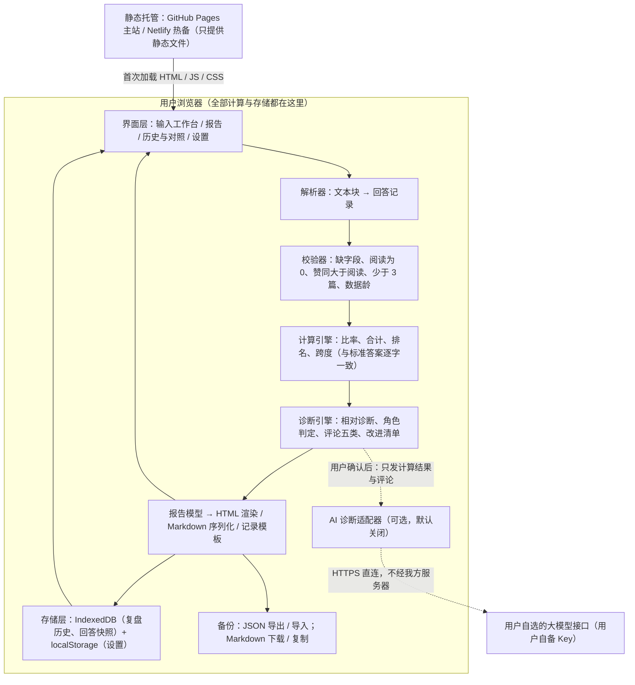
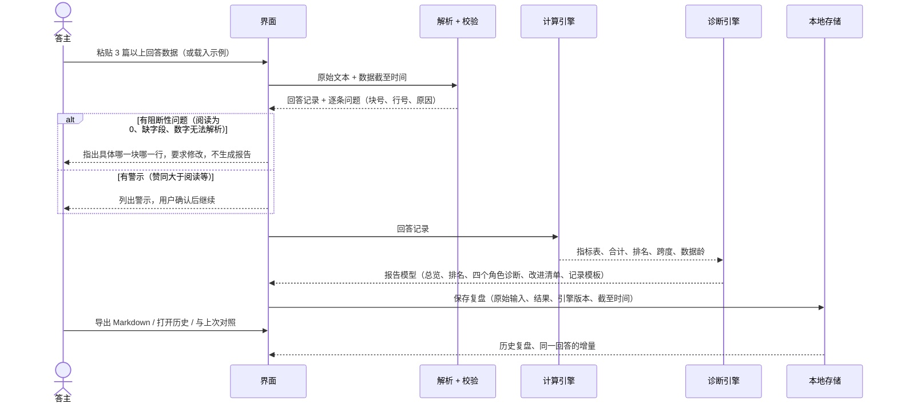

# 架构说明

> 本文档面向想理解或参与本项目开发的读者：系统分层、一次复盘的数据流、完整项目结构树、核心模块职责、数据模型、存储与 AI 链路。
>
> 设计层面的论证（指标口径、相对诊断、风险）见 [01-feasibility-architecture.md](01-feasibility-architecture.md)；模块级规格（函数签名、解析与诊断规则）见 [02-detailed-design.md](02-detailed-design.md)。

## 1. 总览

本项目是一个**纯前端静态单页应用**：全部计算与存储都在用户浏览器内完成，没有后端、没有账号、不登录。静态托管只提供文件。



### 分层原则

| 原则 | 说明 |
| --- | --- |
| 纯函数核心 | 解析器、校验器、计算引擎、诊断引擎、Markdown 序列化全部是无 DOM、无存储、无网络的纯函数；在 Node 下单测，在浏览器中复用同一份代码 |
| 单一报告模型 | 界面渲染和 Markdown 导出都从同一个报告模型生成，保证“屏幕上看到的”和“导出的”数字一致 |
| 引擎版本号 | 每次复盘保存时记录引擎版本和规则参数（如数据龄阈值），历史报告可原样重现，规则升级不篡改旧结论 |
| 用户输入一律转义渲染 | 用户内容与 AI 输出转义后插入 DOM，不使用 Markdown 解析库渲染，消除 XSS 面 |
| 安全头 | 页面设置内容安全策略（CSP），默认只允许本站资源；`connect-src` 仅放行 AI 适配器支持的大模型域名（未启用 AI 时无外连） |

## 2. 一次复盘的数据流



## 3. 项目结构

完整结构树（与仓库实际落盘一致；`node_modules/`、`dist/`、`coverage/`、`reference/` 不入库，见 `.gitignore`）：

```text
zhihu-answer-review-assistant/
├──.github/
│ └── workflows/
│ └── ci-deploy.yml # CI：门禁扫描 → 类型检查 → 覆盖率测试 → 构建 → Pages 发布
├──.gitignore
├── BRIEF.md # 项目简报：赛事、需求、原创性红线、阶段计划（任务来源）
├── CONTRIBUTING.md # 贡献指南
├── LICENSE # MIT 许可证
├── README.md # 项目说明（本文件）
├── index.html # 单页入口（含 CSP meta 与挂载点 #app）
├── jsconfig.json # 开启 checkJs（JSDoc 类型检查）
├── netlify.toml # Netlify 热备站构建配置（Node 22）
├── package.json # 仅 devDependencies，无运行时依赖
├── package-lock.json
├── vite.config.js # Vite 构建（base './'、target es2022）与 Vitest 配置
├── docs/
│ ├── 01-feasibility-architecture.md # 阶段一：可行性分析与架构设计
│ ├── 02-detailed-design.md # 阶段二：详细设计
│ ├── ARCHITECTURE.md # 本文件：架构说明
│ └── TECH-STACK.md # 技术选型
├── scripts/
│ └── lint-guard.mjs # 原创性与安全门禁扫描（文案扫描 + 凭证扫描 + 隔离检查）
├── src/
│ ├── main.js # 应用启动、存储探测、路由与事件总线、状态管理
│ ├── types.js # 全局 JSDoc @typedef 定义
│ ├── core/ # 无 DOM / 无存储 / 无网络
│ │ ├── round.js # 精确十进制格式化与半偶舍入
│ │ ├── date.js # 墙钟日期解析与整天差计算
│ │ ├── parser.js # 块切分、标签别名解析、数字解析、隐私打码
│ │ ├── validator.js # 阻断错误、软警示、别名提示、不足 3 篇检查
│ │ ├── calculator.js # 比率、合计、排名、跨度、收赞比、增量计算
│ │ ├── comments.js # 知乎五类评论分类器
│ │ ├── diagnoser.js # 相对诊断、数据龄、小样本、四角色、改进清单
│ │ ├── report.js # ReportModel 构建与 Markdown 序列化
│ │ └── zhihu-sample.js # 内置知乎虚构示例文本 + 预生成 AI 示例结果
│ ├── storage/ #
│ │ ├── idb.js # IndexedDB 薄封装与降级 MemoryStore
│ │ ├── review-store.js # Review / AnswerIndex 读写与跨期增量查询
│ │ ├── settings-store.js # localStorage 设置 + Key 管理（sessionStorage / localStorage）
│ │ └── backup.js # JSON 备份导出 / 校验 / 导入 + Markdown 下载 / 复制兜底
│ ├── ai/ #
│ │ ├── providers.js # 8 家内置服务商配置 + 自定义服务商校验
│ │ ├── prompt.js # 脱敏载荷构造与提示词拼装
│ │ ├── client.js # OpenAI 兼容 fetch 调用、超时与错误分类
│ │ └── verifier.js # AI 输出引用数字核验器
│ └── ui/ # 纯文本转义渲染，防 XSS
│ ├── dom.js # el()、escapeHtml()、toast、modal 基础件
│ ├── app-shell.js # 顶栏导航、降级横幅、状态管理
│ ├── workspace-view.js # 输入工作台（粘贴区、逐篇辅助录入、截至时间、载入示例）
│ ├── report-view.js # 复盘报告渲染、导出按钮组、AI 诊断面板
│ ├── history-view.js # 历史记录列表、单回答跨期增量对比、删除
│ ├── settings-view.js # 规则参数设置、BYOK 配置、JSON 备份导入导出
│ └── styles.css # 响应式样式（375px 移动优先适配）
└── tests/
├── fixtures/
│ ├── oracle-zhihu.txt # 回归固件：知乎字段名版示例数据
│ ├── oracle-expected.json # 回归固件：固化的纯数字标准答案
│ ├── differential-350k.json.gz # 差分回归固件：35 万组用例
│ └── comment-corpus.json # 评论分类测试语料（每类 ≥ 10 条）
├── unit/ # 12 个单元测试文件
└── regression/ # oracle-parity.test.js + differential-350k.test.js
```

## 4. 核心模块职责

### 4.1 纯函数核心（`src/core/`）

| 模块 | 职责 | 输入 | 输出 | 依赖 |
| --- | --- | --- | --- | --- |
| `round.js` | 与 Python 参考实现逐字一致的半偶舍入与百分比格式化 | `number \| null` | `number` / `string` | 无 |
| `date.js` | 墙钟日期解析、日期格式校验、UTC 整天差与数据龄计算 | 日期字符串 / UTC 毫秒 | `ParsedDate \| null` / 整天数 | 无 |
| `parser.js` | 文本分块、别名映射、数字解析、评论区提取与隐私打码 | 原始粘贴文本、选项 | `ParseResult`（含块级 / 行级定位） | `round.js`、`date.js` |
| `validator.js` | 阻断问题检查、软警示、样本数 < 3 判定 | `ParseResult`、`Settings` | `ValidationResult` | `parser.js` |
| `calculator.js` | 比率、合计、加权均值、稳定排名、跨度、收赞比、跨期增量 | `AnswerInput[]`、`asOfUtcMs` | `BatchMetrics` | `round.js`、`date.js` |
| `comments.js` | 知乎五类评论分类、计数、隐私脱敏 | 评论字符串数组 | `CommentAnalysis` | 无 |
| `diagnoser.js` | 相对诊断、数据龄降级、小样本限制、四角色、行动清单（≤ 5 条） | `BatchMetrics`、历史基线、`Settings` | `DiagnosisResult` | `calculator.js`、`comments.js`、`round.js` |
| `report.js` | 组装唯一 `ReportModel` 并序列化为 Markdown 与下次模板 | `BatchMetrics`、`DiagnosisResult`、元信息 | `ReportModel`、`string` | `round.js`、`date.js` |
| `zhihu-sample.js` | 内置知乎虚构示例文本与预生成 AI 示例结果 | — | 示例文本、示例诊断 | 无 |

模块依赖方向：`ui/*` → `core/*`；`report` → `diagnoser` → `calculator` → `round` / `date`；`validator` → `parser`。核心模块之间不依赖 DOM、存储与网络。

### 4.2 本地持久化（`src/storage/`）

| 模块 | 职责 |
| --- | --- |
| `idb.js` | IndexedDB 打开 / 迁移 / CRUD，不可用时自动降级为内存存储（`MemoryStore`）并返回降级标志 |
| `review-store.js` | 复盘存档、按“规范化标题 + 发布日期”检索同名历史快照、计算跨期增量 |
| `settings-store.js` | 规则设置（`localStorage`）与 AI Key（默认 `sessionStorage`，可选 `localStorage`）读写 |
| `backup.js` | JSON 备份生成与校验导入、Markdown 文件下载与剪贴板兜底 |

### 4.3 AI 诊断适配器（`src/ai/`，可选）

| 模块 | 职责 |
| --- | --- |
| `providers.js` | 8 家内置 OpenAI 兼容服务商配置、自定义服务商校验（要求 HTTPS Base URL） |
| `prompt.js` | 脱敏载荷构造与提示词拼装（评论先打码再发送） |
| `client.js` | OpenAI 兼容 `fetch` 调用、`AbortController` 超时与错误分类（Key 无效 / 额度耗尽 / 网络不可达 / 超时 / 跨域被拒） |
| `verifier.js` | AI 输出引用数字核验器：逐项核对 AI 文本中引用的数字是否存在于计算结果中 |

### 4.4 视图层（`src/ui/`）

| 模块 | 职责 |
| --- | --- |
| `dom.js` | `el()`、`escapeHtml()`、toast、modal 基础件 |
| `app-shell.js` | 顶栏导航、降级横幅、状态管理 |
| `workspace-view.js` | 输入工作台：粘贴区、逐篇辅助录入、数据截至时间、载入示例 |
| `report-view.js` | 复盘报告渲染、导出按钮组、AI 诊断面板 |
| `history-view.js` | 历史记录列表、单回答跨期增量对比、删除 |
| `settings-view.js` | 规则参数设置、BYOK 配置、JSON 备份导入导出 |
| `styles.css` | 响应式样式（375px 移动优先适配） |

应用入口 `src/main.js` 负责启动、存储探测、基于 hash 的视图路由（`workspace` / `report` / `history` / `settings`）与事件总线。

## 5. 数据模型

| 实体 | 主要字段 | 说明 |
| --- | --- | --- |
| 复盘 Review | id、创建时间、数据截至时间、原始输入文本、引擎版本、规则参数、回答快照列表、报告模型、AI 诊断（可选） | 一次复盘一条 |
| 回答快照 AnswerSnapshot | 标题（问题标题）、发布时间原文、解析后时间、阅读、赞同、收藏、评论、喜欢（可选）、分享（可选）、代表性评论（≤ 5）、类型标签（可选） | 嵌在复盘里 |
| 回答索引 AnswerKey | 规范化标题 + 发布日期 → 出现过的复盘 id 列表 | 支撑跨期增量对照 |
| 设置 Settings | 数据龄阈值、小样本阈值、AI 服务商与模型、是否记住 Key | localStorage |

## 6. 计算口径与精确舍入（核心正确性规则）

### 6.1 公式

- 赞同率 = 赞同 ÷ 阅读 × 100%；收藏率 = 收藏 ÷ 阅读 × 100%；评论率 = 评论 ÷ 阅读 × 100%
- 互动率 =（赞同 + 收藏 + 评论）÷ 阅读 × 100%（仅作本批排序键）
- 收赞比 = 收藏 ÷ 赞同（赞同为 0 时为 `null`，显示 `—`）
- 批次加权平均互动率 = 总互动 ÷ 总阅读 × 100%（不是各篇简单平均）
- 中位数：忽略空值，升序排列；奇数取中间值，偶数取中间两项算术平均

### 6.2 精确舍入规则（勿改）

本项目的计算结果必须与 Python 参考实现**逐字一致**，朴素的 JS 实现会在以下三处漂移；修正方案已在 `round.js` / `date.js` / `calculator.js` 中实现，修改计算代码时必须保持：

1. **百分比格式化**：先取双精度的精确十进制展开（`toFixed(100)`），再在字符串上做“四舍六入五成双”。JS 的 `toFixed(2)` 在精确平局时取较大值，会不一致（实测：阅读 32、赞同 1 时，参考实现输出 `3.12%`，朴素 JS 输出 `3.13%`）。
2. **数字取整**：`floor` 后判断小数部分是否恰为 0.5，平局取偶；JS 的 `Math.round` 是“.5 进位”，不可直接用。
3. **计算顺序**：比率严格按 `数值 ÷ 阅读 × 100` 的顺序计算（先除后乘，两次浮点舍入）；不可改写为 `数值 × 100 ÷ 阅读`。
4. **日期**：所有日期按 UTC 墙钟时间解析，整天差向下取整；不受用户浏览器时区与夏令时影响。
5. **排序**：稳定降序排列，并列时保持输入顺序；阅读为 0 的排最后。

回归保障：247,030 组比率格式化用例 + 100,000 组数字解析用例，差分回归 0 差异（`tests/regression/differential-350k.test.js`）；示例数据 Oracle 一致性回归（`tests/regression/oracle-parity.test.js`）。改动计算代码后必须跑 `npm run test:regression`，任一用例不一致即 CI 阻断。

### 6.3 相对诊断规则（摘要）

- 放弃绝对阈值：每篇的各项比率以“为本批中位数的 X 倍”呈现；≥ 1.50 倍为“明显高于本批”，≤ 0.67 倍为“明显低于本批”（约定值，非平台标准，报告中写明）。
- 四个角色：本期表现最优（互动率最高，优先非小样本）、本期干货标杆（收赞比与收藏率）、本期最需警惕（互动率最低）、最值得改的一篇（潜在互动缺口 = 阅读 ×（本批互动率中位数 − 该篇互动率），取最大正值）。
- 数据龄 < 阈值（默认 7 天，可调）的结论自动标注“仅供参考”；小样本（默认 < 200 阅读）不被选为“最优 / 标杆”。
- 改进清单最多 5 条，每条含问题定位、证据数字、具体改法、三档优先级（立即编辑原回答 / 下一篇回答应用 / 记录观察）。
- 评论五类优先级：质疑求证 > 追问 > 催更 / 蹲后续 > 收藏标记 > 认可 > 未分类；一条评论只归一类，保证计数可验算。

完整规格见 [02-detailed-design.md](02-detailed-design.md) §3。

## 7. 存储与备份

- **IndexedDB**：复盘历史与回答快照；启动时探测，不可用时降级为内存保存并在界面顶部明示。
- **localStorage**：规则设置（数据龄阈值、小样本阈值、AI 服务商与模型、是否记住 Key）。
- **sessionStorage**：AI Key 默认存放位置，关闭页面即删。
- **备份**：JSON 导出 / 校验 / 导入（`backup.js`）；Markdown 下载，移动端或内置浏览器下载被拦截时退化为“复制到剪贴板”，再退化为“全选文本框”。

## 8. AI 链路（可选，默认关闭）

```text
报告模型 → 脱敏（评论打码）→ 用户确认告知 → OpenAI 兼容接口直连
→ 错误分类提示 → 输出数字核验 → 渲染到报告页 AI 面板
```

- 内置服务商：DeepSeek、Moonshot、通义 DashScope、OpenAI（CORS 预检已放行）；智谱 AI、豆包、硅基流动、OpenRouter（待验证）。
- 自定义服务商：名称 + HTTPS Base URL + 默认模型，保存前可做连通性测试。
- 内置示例数据配有预先生成的 AI 诊断（界面明确标注“示例输出，非实时”），不联网也可查看 AI 诊断形态。
- 失败分类：Key 无效、额度耗尽、网络不可达、超时、跨域被拒，各有中文说明，不静默失败。

## 9. 测试结构

| 目录 | 内容 | 规模（实测） |
| --- | --- | --- |
| `tests/unit/` | 12 个单元测试文件：解析、舍入、日期、计算、诊断、评论分类、报告、校验、存储、AI 核验、AI 续问、界面流程 | 63 个用例 |
| `tests/regression/` | `oracle-parity.test.js`（示例数据一致性）、`differential-350k.test.js`（35 万组差分） | 4 个用例 |
| `tests/fixtures/` | 标准答案固件、差分用例固件、评论语料 | — |

合计 **14 个测试文件、67 个用例，全部通过**；核心模块（`src/core`）语句覆盖率 97.76%，函数覆盖率 100%。

## 10. 部署与 CI 流水线

```text
push / PR 到 main
→ GitHub Actions（.github/workflows/ci-deploy.yml）
→ npm ci
→ npm run lint:guard（原创性与安全门禁扫描）
→ npm run typecheck（JSDoc 类型检查）
→ npm run test:coverage（测试 + 核心模块覆盖率）
→ npm run build（Vite 构建）
→ main 分支：上传 dist 产物 → 部署到 GitHub Pages
→ Netlify 按 netlify.toml 同构发布热备镜像
```

构建产物：JS 约 134 KB（gzip 约 45 KB），CSS 约 15 KB（gzip 约 3.5 KB）。
